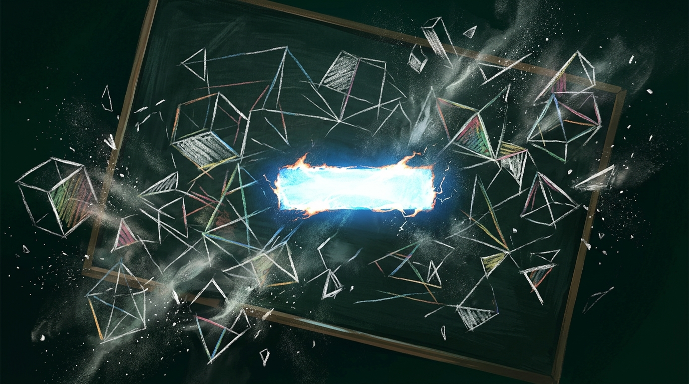

La semana pasada OpenAI soltó su release matemático más ambicioso: **722 manuscritos** con resultados generados por IA, incluyendo pruebas que rozan lo legendario (Unique Games Conjecture, L=BPL). Al día siguiente, el **log de versiones en GitHub** registró lo que nadie esperaba menos: la **retirada de 3 papers** por... un **error de signo**.

## Un signo menos, tres papers menos

El origen del problema: "Algebraicity of Weil classes on split abelian eightfolds". Un error de signo invalidó un argumento de cancelación de traza de estabilización, y como las matemáticas son un castillo de naipes con rigor, **la falla se arrastró a dos papers dependientes**, incluyendo "The rational Hodge conjecture for products of K3 surfaces". El catálogo queda en **719 manuscritos**, con **14 reparaciones de pruebas** adicionales en camino.

Nadie murió y la corrección pública es, en realidad, una buena práctica de ciencia abierta. Pero el episodio ilustra el estado del arte: la IA genera demostraciones masivas con certificados Lean verificables, y aun así **los errores humanos-clásicos aparecen en el corazón del pipeline**.

## El detalle inquietante de Aaronson

Scott Aaronson, que sigue de cerca este show, aportó dos datos para nada menores:

- OpenAI reveló que los **372 resultados nuevos** del modelo sin lanzar salieron casi todos de **un único prompt a un solo agente** — un approach mucho más barato que el enjambre de 10.000 agentes que resolvió Navier–Stokes. El modelo atacó ~8.000 problemas abiertos, resolviendo **~5% con ~3 horas de cómputo cada uno**.
- Y la línea que debería encender alarmas: **los labs frontera ya están probando en silencio si sus modelos más capaces en matemáticas pueden romper primitivas criptográficas**. Aaronson también cuenta que los writeups en lenguaje natural fueron descritos por matemáticos como "escritos por alguien en ácido" — con certificados formales impecables y prosa psicodélica.

OpenAI, mientras, sigue sin publicar los prompts ni los tiempos de cómputo por problema, pese a que su propio grupo asesor pidió disclosure completo.

## El balance

719 papers que aguantan, 3 que no, y la criptografía mirándose al espejo. Por ahora, la conclusión es la de siempre en esta era: **verificar es el nuevo generar** — y quien confíe ciegamente en el output, sin el chequeo formal detrás, termina retirando papers al día siguiente de publicarlos.
