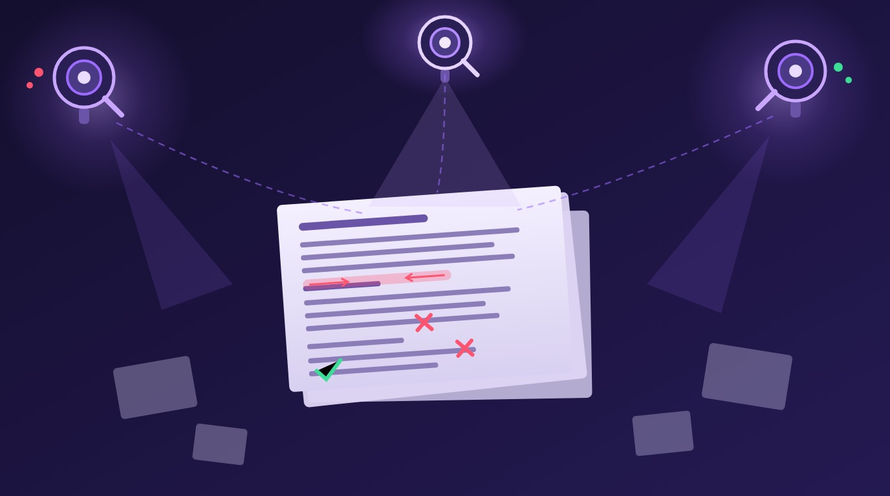

Sakana AI — el laboratorio japonés ya conocido por su trabajo en orquestación de agentes y ciencia autónoma — publicó **MLR (Multi-Layered Review)**, un sistema de revisión por pares asistida por LLM que imita cómo un buen revisor humano estructura su trabajo: primero entender a fondo, recién después criticar. El resultado de cabeza: **detectó el 73,43% de los errores plantados que afectan el claim central de un paper**, contra el **14,81%** del mejor sistema previo (AgentReview). Cinco veces mejor suena bien… hasta leer el asterisco.

## Cómo está armado

MLR usa **tres roles con agentes Claude**:

- **Appendix Agent** (Claude Haiku 3.5): resume el apéndice y los detalles técnicos.
- **Literature Review Agent** (Claude Sonnet 4 + búsqueda web): construye el contexto de literatura relevante.
- **Review Agent** (Claude Sonnet 4): el corazón del sistema — **tres pasadas sobre el texto principal** para entenderlo profundamente antes de generar la revisión, al estilo de un revisor humano que primero digiere el paper completo.

## El benchmark y el asterisco grande

La evaluación se hizo sobre un **Contradiction Benchmark con 1.164 errores sintéticos plantados en 257 papers publicados en conferencias reales** (paper: *Beyond Imitation: A Framework and Benchmark for LLM-Assisted Peer Review*, arXiv 2610.11087). Ahí MLR brilla: 73,43% de detección en errores del claim central, y **60,79% con una sola pasada de revisión**.

Pero cuando lo probaron contra **problemas documentados en papers de arXiv retirados de verdad**, la detección se desplomó a **16,11%**. O sea: el sistema es excelente cazando contradicciones del tipo "el abstract dice X y la sección 4 dice lo contrario", pero los problemas reales de un paper que valen una retractación — datos manipulados, metodologías mal aplicadas, fraude sutil — son otro animal.

## La lectura pragmática

- Las ablaciones del paper muestran que **el diseño importa tanto como el modelo**: la misma arquitectura cambia bastante de rendimiento según qué modelo alimenta cada agente.
- Para equipos que usan LLMs en code review o QA, hay una lección transferible: **los benchmarks con errores plantados sobrestiman el desempeño en errores reales**. Si van a evaluar agentes revisores, mejor probar con defectos del mundo real que con contradicciones sintéticas.
- La revisión por pares no va a ser reemplazada todavía — pero sí asistida. Detectar el 73% de contradicciones internas antes de que un revisor humano abra el paper ya es un aporte.

**Fuente:** [MarkTechPost](https://www.marktechpost.com/2026/10/10/sakana-ais-llm-peer-review-system-catches-73-of-core-claim-errors/) · [Paper en arXiv](https://arxiv.org/html/2610.11087v1) · [AI Weekly](https://aiweekly.co/ai-news-today)
