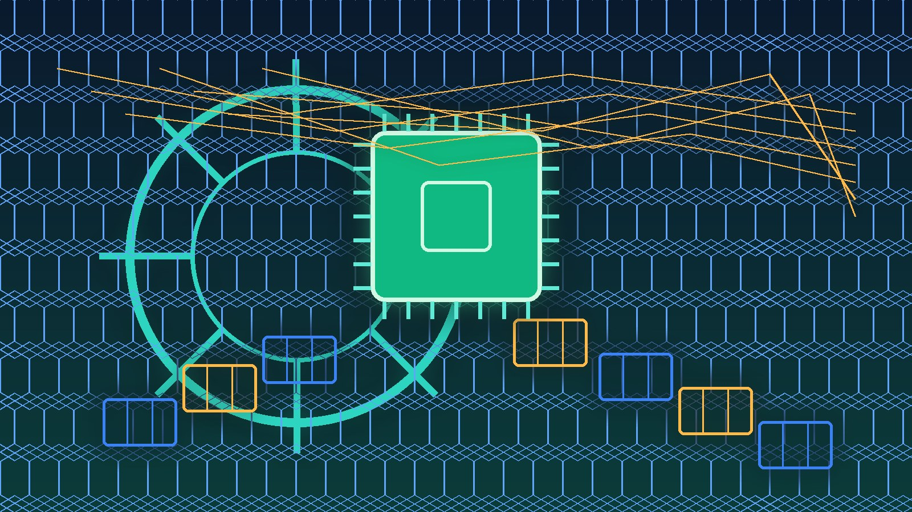

The New Stack publicó un análisis que duele y se siente real para cualquier platform team que ya compartió GPUs en Kubernetes: **mientras CPU y memoria vienen con métricas por pod, rightsizing y cost splits nativos, las GPUs compartidas no traen nada de eso**. La conclusión del título es directa: GPUs en K8s son bring-your-own-everything, empezando por la cuenta.

## Los problemas, en concreto

- **Utilización que miente**: DCGM (el exporter estándar de NVIDIA) reporta a nivel del dispositivo físico. Con time-slicing o MPS, el driver expone un solo set de contadores para toda la GPU, así que **cada pod compartiendo la GPU ve el mismo valor**: tres pods en una GPU pueden aparecer cada uno al 100%, sumando un inexistente 300%.
- **La métrica de "uso" no mide lo que crees**: el signal per-process de NVIDIA solo indica si un proceso estaba activo en el instante del muestreo, no cuánto trabajo hizo. Dos jobs corriendo lado a lado pueden mostrar ambos 90% "busy" sin forma de saber quién hizo más.
- **Atribución de cómputo: hoy imposible**: entre workloads co-ubicados, **no hay forma justa de dividir el cómputo con las herramientas actuales**. La memoria (vía NVML) sí es confiable — si vas a hacer chargeback, cobra por memoria GPU.
- **Agujero de aislamiento**: las imágenes base CUDA traen `NVIDIA_VISIBLE_DEVICES=all`. Si el device plugin no lo pisa, un pod puede **ver y agarrar todas las GPUs del nodo**, sin importar lo que el scheduler le asignó.
- **Scheduling rígido**: requests deben igualar limits, sin overcommit a nivel scheduler.
- **Cada modo de sharing cambia el significado de "asignado"**: time-slicing, MPS, MIG y DRA redefinen qué significa que una GPU esté "allocated", complicando aún más la observabilidad.

## El golpe FinOps

Encima de todo, la factura del cloud **lump GPU, CPU y memoria en una sola línea**, obligando a los platform teams a construir lógica custom de split para — irónicamente — el ítem más caro de la cuenta. O sea: pagas el hardware más caro del cluster y luego tienes que construir tu propio sistema de visibilidad para saber quién lo ocupa.

## Qué llevarse

Si tu equipo comparte GPUs o planea hacerlo: desconfía de los dashboards de utilización (verifica si DCGM reporta por dispositivo), considera MIG cuando el hardware lo permita (particiones reales, métricas reales), audita el `NVIDIA_VISIBLE_DEVICES` de tus imágenes, y para chargeback **usa memoria GPU, no cómputo**, mientras el ecosistema (DRA va en esa dirección) madura.

**Fuente:** [The New Stack](https://thenewstack.io/gpus-on-kubernetes/)
