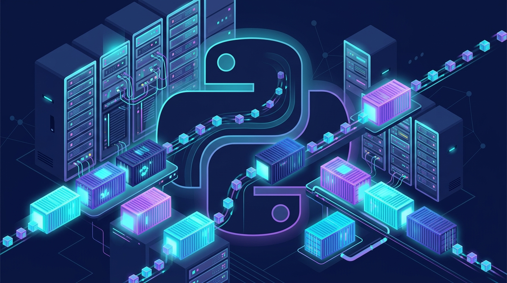

Vercel quiere dejar de ser "el lugar donde vive el frontend". En su conferencia **Ship** en San Francisco anunció tres piezas que lo meten de lleno en el negocio del backend completo: **Python en disponibilidad general, soporte de contenedores en Vercel Functions y Daemons**, workers en background siempre activos que llegan en beta pública.

## Python: ya no es ciudadano de segunda

Python en Vercel pasó de preview a **GA**: FastAPI, Flask y Django corriendo sobre CPython estándar con dependencias de PyPI, con detección de framework, builds y escalado a cargo de la plataforma. El número de contexto: ya son **150.000 equipos** con backends Python en Vercel, incluyendo gente de OpenAI, Polymarket y Exa.

El caso que muestran: **Delphi**, que construye "mentes digitales" con IA, migró su backend Python de AWS ECS a Vercel. Con diez ingenieros y nadie dedicado a infraestructura, hacen **más de 100 deploys a producción al día**.

## Contenedores: cualquier lenguaje, tu runtime

El soporte de contenedores (en beta desde hace unos meses) permite empaquetar apps en cualquier lenguaje con las librerias de sistema que necesiten — piensa en un `ffmpeg` para procesar video. Ya son **5.000 equipos con 150.000 despliegues** de contenedores. Los contenedores corren como Vercel Functions sobre **Fluid compute** con *Active CPU pricing*: no te cobran el tiempo idle esperando respuestas de APIs, bases de datos o inferencia de LLMs.

## Daemons: el fin del "serverless solo para requests"

La pieza más interesante. **Vercel Daemons** (beta pública) permite desplegar contenedores como **procesos en background continuamente corriendo**: eliges cuántas instancias por región, y Vercel mantiene esa capacidad reiniciando procesos si se caen. El modelo es *pull-based*: tu código pide trabajo a colas (Vercel Queues, SQS, Kafka, Redis) o consulta jobs pendientes en una base de datos. Casos de uso claros: consumers de colas, workers de workflows tipo Celery/Sidekiq/BullMQ, transcoding de video, tareas CPU-bound que no calzan en el modelo de funciones efímeras.

## Drives: memoria persistente para agentes

Junto con todo esto llega **Vercel Drives**, workspaces persistentes para agentes de IA: código, datos y memoria guardada sobreviven independientes del sandbox, permitiendo que un agente retome trabajo entre ejecuciones en vez de reconstruir su entorno cada vez. Tiene sentido si consideras el dato que dio Guillermo Rauch: el **60% de la actividad en Vercel ya es generada por agentes de código**.

## Por qué importa

La jugada es clara: Vercel pasó de hosting de frontends a plataformota full-stack — frontend, APIs, colas, workflows durables, contenedores y ahora procesos always-on. Con Python GA y Drives para agentes, apunta directo al flujo de trabajo de equipos que construyen productos con IA sin querer operar infraestructura tipo ECS o Kubernetes. El trade-off de siempre: más conveniencia a cambio de más lock-in. Pero la tendencia es innegable: la línea entre "deploy de un sitio" y "operar un backend" se está borrando.
