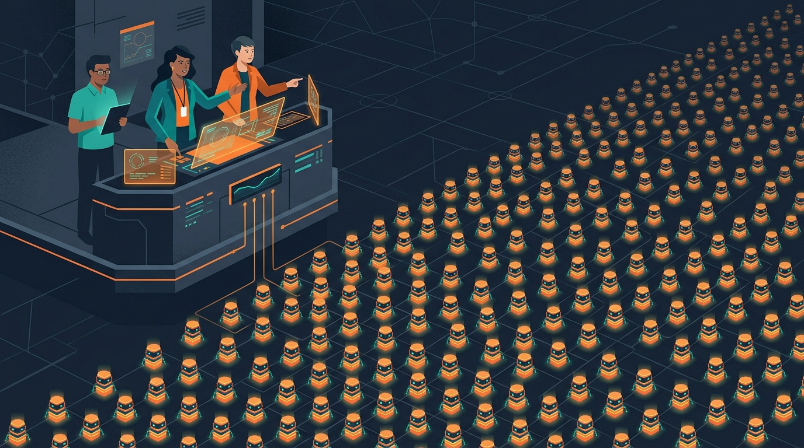

Anthropic publicó un estudio que cualquier equipo de ingeniería debería leer dos veces: **"How employment is changing at Anthropic"**, un análisis con datos internos completos — empleo, uso de IA, métricas de output, calendarios, encuestas y registros de decisiones de contratación, más 17 entrevistas a empleados. Sin maquillaje: la empresa que está en la frontera de adopción de IA muestra cómo se ve la organización cuando los agentes ya son la mayoría del "equipo".

## Los números duros

- Las **horas de trabajo de agentes de IA interactivos superaron por primera vez las horas humanas en marzo**, y para agosto la proporción llegó a **6 a 1**
- La proporción de empleados de nivel junior en departamentos técnicos cayó de **21% a 14%** desde inicios de 2025
- La contratación junior técnica se desplomó aún más rápido: de **27% a 9%** de las contrataciones, con los avisos cayendo con fuerza desde diciembre de 2025
- Los ingenieros multiplicaron por **~5 sus commits en seis meses**
- Sesiones de agentes de código para empleados **no técnicos**: de 2 por mes (agosto 2025) a **90 por mes** (mayo 2026). Una vendedora se armó su propio dashboard con MCPs en tres horas
- A los cinco años de vida, Anthropic genera **2 a 4 veces más ingresos por empleado** que Meta y Google al mismo punto de su crecimiento

## El cuello de botella cambió de lado

Para los que trabajan en DevOps esto va a sonar familiar: el problema ya no es producir, es **procesar lo producido**. El informe lo dice sin rodeos — incluso entre empleados no técnicos, **leer todo el output de sus agentes Claude tomaría la mitad de la semana laboral**. Un ingeniero lo resume brutal: *"es un ejército de Claudes, cada uno pidiendo mi atención"*.

La respuesta organizacional es lo que el informe llama **"meta-work"**: construir herramientas de visibilidad y monitorear pipelines de agentes. Suena sospechosamente a lo que ya hacemos con observabilidad de sistemas, pero aplicado a la fuerza laboral artificial.

## Qué buscan al contratar ahora

Los hiring managers de Anthropic han girado hacia **autonomía y juicio** por sobre expertise técnico específico e implementación. Las menciones de "proficiencia en herramientas de IA" en las descripciones de cargo **se triplicaron para roles técnicos y se cuadruplicaron para los no técnicos**. La empresa además montó un sistema de alerta temprana para detectar puestos en riesgo de disrupción y prioriza la reubicación interna.

**El resumen**: el debate "¿la IA quita puestos junior?" pasó de anécdota a dataset. En la empresa más avanzada del mundo en adopción, los juniors técnicos son la primera línea afectada, el trabajo humano migra hacia supervisión y arbitraje, y el throughput se dispara. Si tu equipo de plataforma o DevOps sigue contratando como en 2024, este informe es el espejo más honesto que vas a encontrar.
