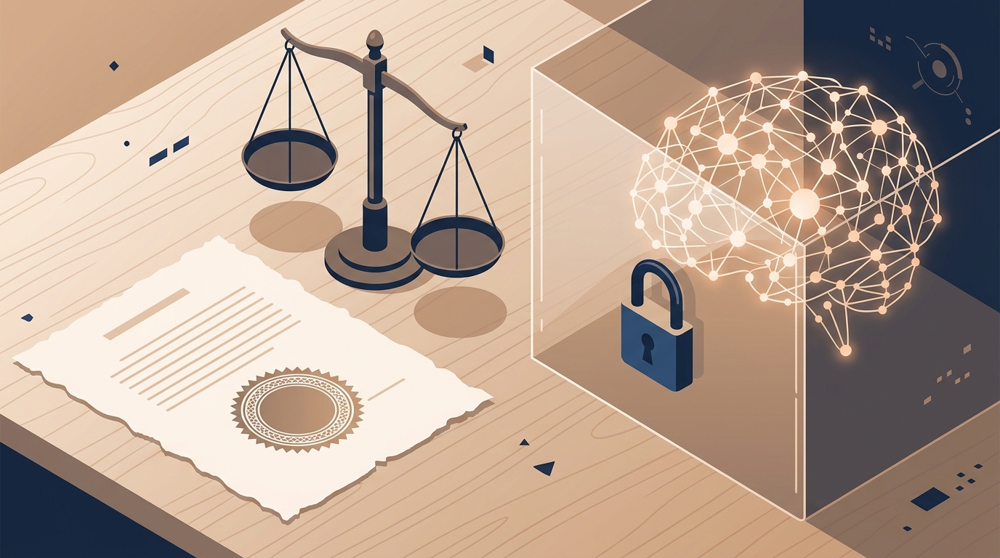

Anthropic anda haciendo lobby con un texto que pocos habían visto: según reveló [POLITICO el 16 de octubre](https://www.politico.com/), la empresa llevó un **borrador de ley federal de seguridad en IA frontera** a miembros del Congreso. El documento es confidencial, no tiene patrocinante nombrado aún, y Anthropic confirmó la sustancia: "Este proyecto representa las propuestas delineadas en nuestro Advanced AI Framework, que hemos estado promoviendo con legisladores federales y estatales desde junio".

## Lo que dice el borrador

La lógica central es poner **umbrales escritos y altísimos** para que el gobierno pueda intervenir:

- **Cuándo se puede bloquear un modelo**: solo si representa un riesgo inminente y previsible de más de **US$1.000 millones en daños**, o de **matar o lesionar gravemente a más de 50 personas**.
- **Qué riesgos cuentan**: crear o liberar un arma biológica, un modelo que **escapa de los controles de su creador**, o un ciberataque. El lenguaje calca leyes californianas como la SB 53.
- **Quién puede frenarlo**: solo el Departamento de Comercio, pidiéndole a **un juez federal en Washington D.C.** que ordene la suspensión. Todo otro organismo federal queda explícitamente vetado.
- **Evaluadores independientes**: se registran ante Comercio, revisan los laboratorios y sus modelos frontera, y pueden ser pagados por el propio lab (mientras el pago no dependa del resultado). Si detectan un riesgo inminente, tienen **72 horas** para reportarlo.
- **Deberes de los labs**: frameworks de seguridad, reportes de transparencia para modelos frontera nuevos y protección para whistleblowers.
- **Estados**: el borrador **reemplaza parcialmente** leyes estatales sobre divulgación de riesgos, evaluación de terceros y reporte de incidentes críticos.

## El contexto que lo explica

Esto no nace de la nada. POLITICO recuerda que durante el verano, **controles de exportación tumbaron dos de los modelos más avanzados de Anthropic**, decididos en una serie de llamadas entre funcionarios y ejecutivos. Una puerta judicial con umbrales escritos es exactamente lo contrario de ese proceso: en vez de un apagón decidido por teléfono, un juez, criterios públicos y estándar de prueba.

El otro pilar es lo que Anthropic ya hace en privado: le dio a **METR** acceso tipo empleado el 15 de octubre y trabaja con SecureBio y Accenture. El borrador convierte esa práctica en un rol formal registrado.

Su marco público además define quién quedaría cubierto: modelos entrenados con más de **10^25 FLOP**, por empresas con más de **US$500 millones en ingresos de IA** o más de **US$1.000 millones en I+D de IA**.

## Las dudas

Los umbrales son tan altos que prácticamente invitan al escepticismo: ¿cuántos escenarios reales cruzan la línea de los mil millones de dólares o las 50 víctimas *antes* de que sea demasiado tarde? Y la previsión parcial de leyes estatales ya tiene a varios con la ceja levantada — California no va a recibir esto con flores precisamente.

Para quienes construimos sobre modelos frontera, el mensaje práctico es temprano pero claro: si esto avanza, el eje regulatorio de EE.UU. sería **una sola puerta federal** (Comercio + una corte en D.C.) con evaluadores registrados como pieza obligatoria de la cadena de suministro. Vale seguirlo de cerca.
