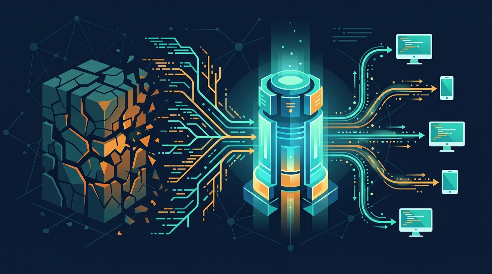

La historia se puso de moda esta semana gracias a The New Stack, pero el pieza central es un post de ingeniería de Anthropic: **la empresa migró su monorepo principal completamente fuera de Git** hacia **Scion**, un sistema de control de versiones construido en casa. Y el motivo no es caprich de arquitecto: es que **el código generado por agentes de IA literalmente rompió Git**.

## Los números del problema

Cuando tus ingenieros (humanos y Claude) trabajan a toda máquina, el repositorio deja de comportarse como un repo normal:

- **2.500 merges diarios en mayo de 2026 → 30.000 diarios en septiembre**. Un salvoconducto de 12x en cuatro meses
- La historia del branch principal creció hacia los **100 GB**, con una working copy comprimida de más de **25 GB**
- Los sistemas de CI ejecutan **~25 millones de checkouts al día**. Si cada runner clonara el repo completo, el tráfico teórico superaría los **600 petabytes**. Sí, petabytes

El modelo distribuido de Git — donde cada cliente guarda toda la historia para trabajar offline — tiene sentido para humanos con laptops. Pero en un entorno de nube dominado por agentes siempre conectados, replicar 100 GB de historia en cada operación es un lujo insostenible.

## La solución: pensar en servidor, no en clientes

Scion invierte la arquitectura de Git. En vez de "cada cliente tiene todo", funciona al revés:

- Los clientes piden **árboles de archivos e historiales on demand**, nada de clonar el mundo
- Un clúster central ejecuta las operaciones pesadas: **commits, merges y rebases viven en el servidor**
- Tiers de proxy regionales cachean objetos de código frecuentes, con **hit rates sobre el 99%**

Los resultados, comparados contra la infraestructura anterior de múltiples espejos Git, son brutales:

- Uso de CPU y memoria central reducido a un **0,05% de los niveles previos**
- Checkouts de CI e investigación **~100 veces más rápidos**
- La organización recuperó el **25% de toda su capacidad de procesadores de CI**

## Siete ingenieros, cinco meses, y Claude en el equipo

El detalle más sabroso: Scion lo construyó un equipo de **siete ingenieros**, y la migración del repo principal tomó **cinco meses**. De paso, Claude mismo ayudó a optimizar el pipeline de conversión de datos — recortando el consumo de memoria **20 veces** y cuadruplicando el throughput. La IA ayudando a construir la infraestructura que la IA necesita para trabajar. Circular, pero eficiente.

## La mala noticia: no lo van a liberar

Anthropic fue clara: **Scion no será open source**. Es una herramienta demasiado específica para monorepos corporativos gigantes y flujos agénticos de alta densidad — adoptar algo así implica migrar búsqueda de código, code review y pipelines de integración completos. Lo que sí publicaron es un **overview arquitectónico** para que la comunidad se inspire en los patrones de escalado server-side. Varios analistas ya especulan que estas ideas van a filtrarse hacia los VCS open source en los próximos años.

**El resumen**: mientras discutimos si Git está muerto a nivel de herramienta, Anthropic ya respondió a nivel de escala — cuando el 95% de tus "committers" son agentes, el control de versiones se vuelve un problema de backend, no de DVCS. Tu repo de 400 MB sigue feliz con Git, pero el techo del modelo clásico ya tiene fecha y número: 30.000 merges diarios.
