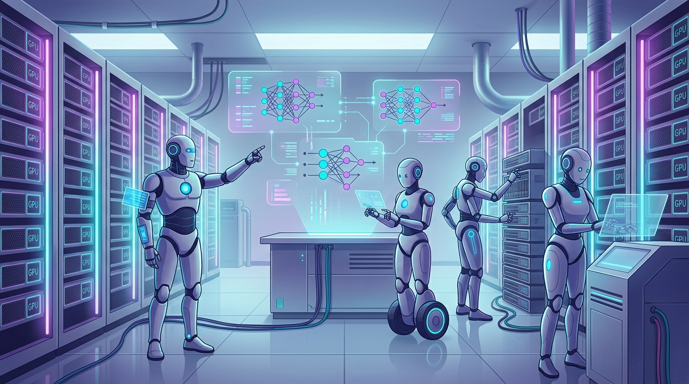

La mejora recursiva de modelos suele discutirse como ciencia ficción distante. El paper de **Athanor** le puso un plazo concreto y medible a la pregunta: ¿pueden agentes de frontera tomar un modelo base crudo, con datos públicos, y convertirlo solos en un asistente competente? La respuesta corta: **sí, en 104 horas y sin profesor**.

## El experimento

Athanor es un sistema abierto diseñado alrededor del flujo de investigación completo, no de una receta de entrenamiento:

- **Cuatro agentes Claude Opus 5.5** (corriendo en Claude Code) trabajaron en colaboración, **cada uno con su propio nodo de 8 GPUs**
- Punto de partida: **Qwen3-4B-Base**, un modelo de 4 mil millones de parámetros sin instrucción
- Los agentes deciden qué probar: leen datasets y resultados, crean ejemplos de entrenamiento, editan algoritmos, ajustan hiperparámetros y analizan fallos
- **Sin atajos**: cero modelos teacher externos, y con una suite de evaluación oculta que los agentes no conocen (para que no puedan optimizar solo el score visible)

## Los números

- Suite de desarrollo (6 tareas): de **15.9 a 67.3** puntos promedio
- Suite oculta (held-out): de **9.2 a 48.2**
- Referencia: el oficial **Qwen3-4B-Instruct-2507** sacó 66.5 y 47.9 en las mismas suites

O sea, el modelo post-entrenado por agentes **empató (y en dev superó por poco) al instruct oficial de Qwen**, que fue entrenado por humanos con toda la infraestructura de la empresa.

## Lo importante: no inventaron nada nuevo

El paper es honesto acá, y eso lo hace más interesante. Los agentes **no descubrieron un paradigma de aprendizaje nuevo**: recombinaron ingredientes conocidos — fine-tuning supervisado sobre datos de razonamiento públicos, RL, un ajuste de rollouts que introdujo uno de los agentes, y modelos creados por sus compañeros de equipo. Athanor evalúa **ejecución de investigación y toma de decisiones iterativa**, tanto como originalidad algorítmica.

La contribución principal es metodológica: convierte la mejora autónoma de modelos en un loop concreto de construcción de datos, cambios de código, jobs de GPU, evaluación y memoria de intentos previos.

## Perspectiva

Que no se confunda esto con "ciencia autónoma": la campaña estuvo acotada a un modelo, un ambiente de datos y una ventana de tiempo específicos. Pero para los equipos de ML engineering, la señal es clara: **el post-training empieza a verse menos como pipeline operado a mano y más como workspace de investigación administrado por agentes**. Los próximos tests son replicación más amplia, campañas más largas y menos supuestos diseñados por humanos.

Si los GPUs se manejan solos, el cuello de botella del ML se corre puro a formular buenas preguntas.

**Fuente:** [Paper en Hugging Face Daily Papers](https://huggingface.co/papers/2610.21055)
