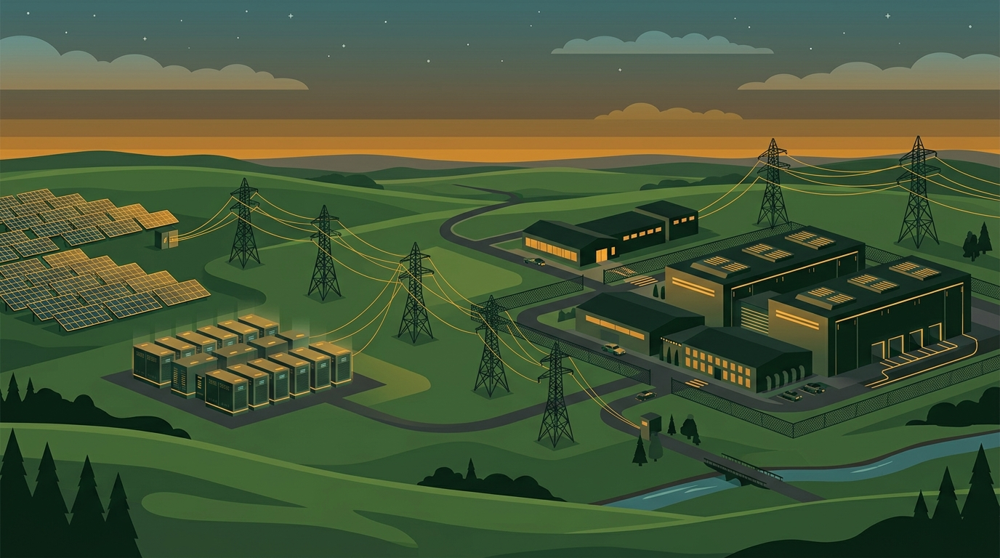

La carrera por asegurar energía para IA sigue produciendo acuerdos cada vez más creativos. El viernes, **NiSource** (matriz de la eléctrica NIPSCO) anunció un contrato de **20 años con Microsoft para suministrar ~1.100 MW de nueva generación** a un campus de data centers en el noroeste de Indiana. El servicio parte en **2028 y corre hasta 2048**.

## La estructura: Microsoft pone la plata, los clientes salen ganando

Lo interesante del acuerdo no es solo el tamaño — 1.100 MW es serio, del orden de un reactor nuclear mediano — sino la estructura financiera:

- **Microsoft financia toda la generación y transmisión** a través de una nueva subsidiaria tipo **GenCo**, blindando a los clientes residenciales de NIPSCO de los costos incrementales
- El paquete incluye **600 MW de almacenamiento en baterías** para gestionar la intermitencia
- NiSource proyecta **~US$1.750 millones en ahorros para los clientes eléctricos existentes** (unos US$140 por cliente al año), gracias a la dilución de costos fijos que aporta este megacontrato

El mercado aplaudió: las acciones de NiSource subieron tras el anuncio, y el argumento es el de siempre en utilities con data centers — visibilidad de carga gigante a 20 años, con infraestructura financiada por el hiperscaler.

## El patrón de fondo

Este cierre es una pieza más de un patrón que ya es imposible de ignorar: los hiperscalers están **comprando energía por décadas y financiando generación propia** porque los interconnection queues y las redes públicas no dan abasto con su apetito. Microsoft ya tiene acuerdos similares con Constellation para reactivar reactores nucleares; acá apuesta por generación nueva financiada directamente, con la eléctrica local como socia operativa.

Para Indiana el mensaje es estratégico también: el estado se posiciona como hub de data centers del medio oeste, compitiendo con los clusters de Virginia, Ohio y el norte de Virginia... que ya no dan abasto ni en terreno ni en megavatios.

**El resumen**: el cuello de botella de la era IA dejó de ser solo el chip — hoy es el enchufe. Microsoft acaba de asegurar 1.100 MW hasta 2048 con una estructura donde financia todo y hasta deja ahorros para los vecinos. Los que creen que la inversión en data centers va a frenar por temas energéticos deberían ver la velocidad a la que los hiperscalers están firmando contratos de 20 años.
