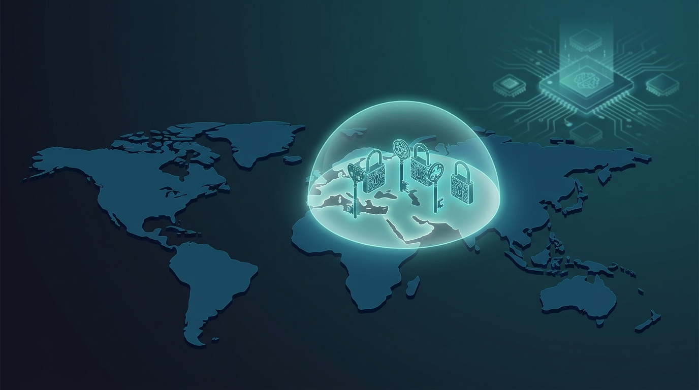

Cloudflare anunció hoy su **PQ GeoKey Manager** en beta cerrada, como pieza angular de su Data Localization Suite: claves de descifrado que **solo pueden abrirse en la geografía que el cliente elija**, ahora protegidas con criptografía post-quantum. GA planeada para Q1 2027.

## El ataque que hay que frenar: harvest now, decrypt later

Gobiernos, bancos, salud y defensa manejan datos que siguen siendo sensibles por décadas. Con criptografía de clave pública clásica, un adversario no necesita computación cuántica hoy para comprometerlos: **graba el ciphertext ahora y espera** a que exista la máquina que rompa la criptografía asimétrica. Por eso la migración a PQ tiene reloj, y Cloudflare la está aplicando también a su stack de soberanía de datos.

## De ABE a ML-KEM: simplificar para sobrevivir

La historia del producto es interesante para los arquitectos: el GeoKey original (2017) restringía geográficamente las private keys TLS; la v2 (2022) usó **attribute-based encryption** para expresar políticas tipo "region = Unión Europea". Pero **no existe hoy un esquema ABE post-quantum listo para producción**, así que Cloudflare rediseñó: híbrido **ML-KEM-768 (estándar NIST) + X25519**, con *regional root keys* simétricas por región y pares de claves derivados por servicio (Gateway, Tunnel, etc.).

Las claves envueltas se distribuyen globalmente vía Quicksilver, pero las *regional root keys* viajan por un camino aparte que **solo llega a los edge servers autorizados de cada región**. Y el sistema **falla cerrado**: si una request de Alemania intentara desencriptarse en España, simplemente falla, porque ahí no existe la root key alemana.

## El punto

Soberanía de datos de verdad no es solo "los datos viven en tal país": es que **ni siquiera la clave para leerlos pueda salir de ahí**, aguantando además la amenaza cuántica. Para cualquier equipo operando con requisitos de residencia de datos (sector financiero, público, salud), este es el tipo de garantía técnica que empieza a marcar diferencia contra las promesas de marketing.

**Enlace:** [Bringing post-quantum cryptography to geographically fenced key management](https://blog.cloudflare.com/post-quantum-geo-key-manager/)
