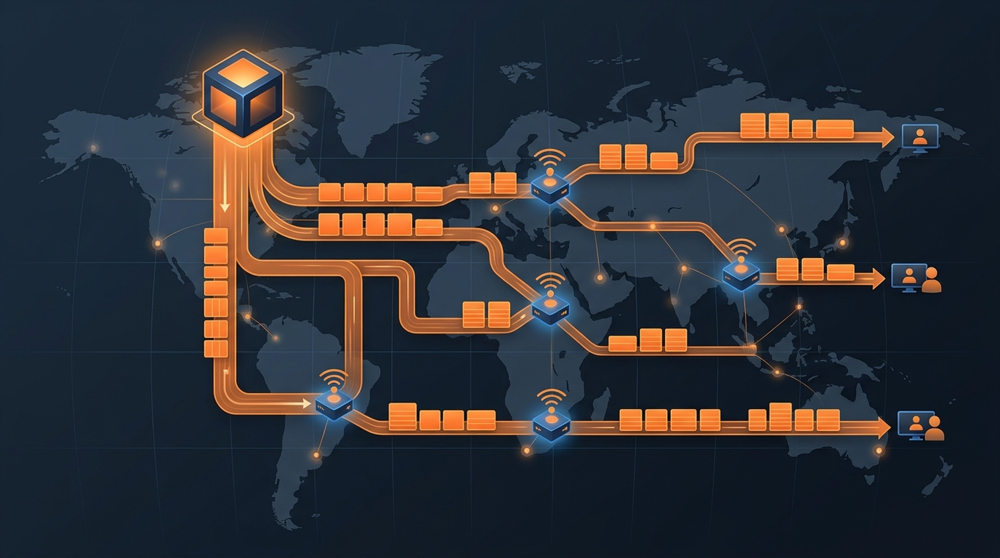

Cloudflare lanzó hoy **Origin Range Requests**, disponible self-service en todos los planes vía Cache Rules. Detrás del nombre aburrido hay una historia buena de ingeniería: reconstruyeron cómo su caché maneja range requests, y los números hablan solos — **el p99 de time-to-first-byte de R2 bajó ~50%** y el tráfico de tiered cache cayó ~6%.

## El problema del tamaño de rango

Cachear `Range: bytes=X-Y` parece trivial, pero el modelo viejo (estilo nginx cache slicing) obligaba a configurar un tamaño de rango fijo por zona, con un trade-off imposible de ganar:

- **Rangos chicos**: lluvia de requests al origen y presión de memoria coalescionando todo en RAM.
- **Rangos grandes**: el clásico "el usuario pidió 2 MB y Cloudflare bajó 128 MiB del origen", a veces para un viewer que ya se fue. Y el sobrante se multiplicaba en cada hop: origen → data center → tier de caché → cliente.

Peor aún: cambiar el tamaño invalidaba la caché (era parte de la cache key), y los requests dentro del mismo rango se bloqueaban entre sí.

## La solución: que el rango sea el chunk

La migración de nginx a **Pingora** dio la excusa para rehacerlo. Pingora ya guarda cada archivo cacheado en disco en **chunks de tamaño fijo** (para resumir descargas interrumpidas). Entonces el rango deja de ser un setting: **simplemente es el chunk**.

Ahora el edge actúa como coordinador: sirve los bytes que ya tiene en caché, baja del origen solo los chunks alineados que faltan, combina datos cacheados + descargas en curso + fetch nuevos, y arma la respuesta `206 Partial Content` con validación de que todo pertenezca a la misma representación (ETag y tamaño estables). Requests concurrentes sobre un archivo popular se **enganchan a una descarga en curso** en vez de duplicar fetches.

## Por qué importa

Si sirves video, descargas grandes, paquetes o artifacts detrás de Cloudflare, esto reduce desperdicio de bandwidth de origen y mejora seeks sin tocar nada de tu lado: un toggle en una Cache Rule. Y es otro capítulo de Pingora demostrando que reescribir el proxy en Rust valió la pena.

**Enlaces:** [Origin Range Requests (blog)](https://blog.cloudflare.com/origin-range-requests/) · [docs de Cache Rules](https://developers.cloudflare.com/cache/how-to/cache-rules/settings/#origin-range-requests)
