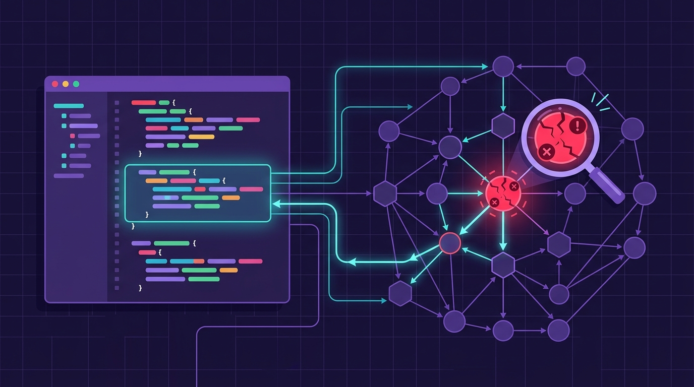

Si hay un patrón repetido en 2026 es este: **la observabilidad tiene que llegar adonde ya está el developer**. Dynatrace lo acaba de formalizar con un anuncio doble: entra como **launch partner de la red de partners de Cursor** (la "SpaceX Super Intelligence Partner Network", desde que Cursor es parte del imperio SpaceX) y publicó un **plugin verificado en el Cursor Marketplace**.

## La desconexión que todos conocen

El problema es viejo: cuando algo se cae en producción, el developer está en su editor y la telemetría vive en otro portal, en otra pestaña, con otro login. Mientras los agentes de IA aceleran la escritura de código, la investigación de incidentes sigue siendo un ejercicio manual de armar contexto a mano entre herramientas. Dynatrace le llama la brecha entre "enviar rápido" y "enviar a ciegas".

## Qué integra el plugin

El plugin lleva al workflow de Cursor las capas que hacen la diferencia en Dynatrace:

- **Grail** como backend de datos para consultar lo que pasa en producción
- **Smartscape** para mapear dependencias de servicios en tiempo real
- **Análisis causal y determinista de causa raíz** (Davis), con la evidencia detrás de la respuesta, no solo la alerta

Los escenarios que destacan: responder incidentes sin salir del editor, investigar regresiones post-deploy con el impacto en usuarios reales visible en el mismo flujo, y pasar de "¿qué servicio se degradó?" a "¿qué código hay que cambiar?" sin reconstruir la investigación entre cuatro consolas.

## El ángulo para platform engineering

Lo interesante para equipos de plataforma: el plugin se puede **distribuir vía team marketplace** con gobernanza central, o sea, los equipos DevEx controlan quién lo habilita y cómo, sin que cada developer instale lo que se le ocurra. "Control is what makes speed safe", resume el post.

El anuncio viene con blog técnico compañero que cubre la configuración de platform tokens, el **MCP server de Dynatrace**, las Dynatrace skills y dtctl. O sea: es una integración pensada para agentes, no solo un panel bonito.

En resumen: otra señal de que 2027 se perfila como el año en que el editor con IA se convierte en la interfaz principal para operar producción — y los vendors de observabilidad van a pelear por estar adentro.

**Enlace:** [Dynatrace and Cursor close the loop on AI-native development](https://www.dynatrace.com/news/blog/dynatrace-and-cursor-close-the-loop-on-ai-native-development/)
