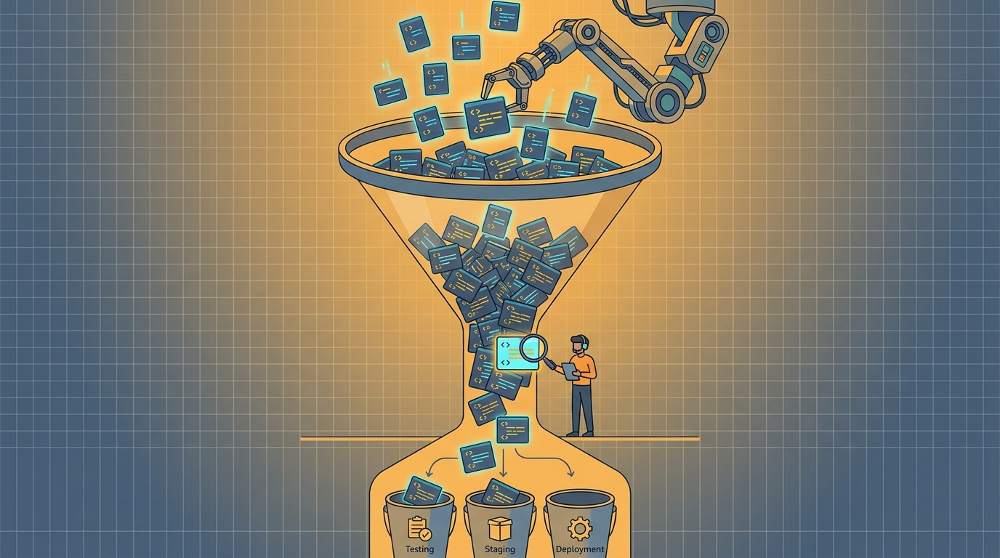

Llegó el estudio que faltaba en la eterna discusión de "¿la IA de coding sirve o no?". Investigadores de Harvard, usando datos de la plataforma de ingeniería **Jellyfish**, analizaron ~**300 millones de eventos de trabajo de 700.000 personas en más de 700 empresas**, entre enero 2021 y marzo 2026, incluyendo uso de GitHub Copilot, Cursor y Claude Code. El resultado es de esos que duelen: **la IA genera mucho más código, pero mucho menos trabajo terminado de lo que prometen las métricas de código**.

## Los números, sin filtro

- **Asistentes de IA**: +12% en líneas de código, +9% en commits, +5% en PRs (solo el efecto en commits fue estadísticamente significativo)
- **Agentes de IA**: +30% líneas de código, +20% commits, +23% PRs — todos significativos
- **Pero** en issues de Jira resueltas por worker al mes: los asistentes no mueven la aguja, y los agentes aportan solo **+12%**

O sea: 30% más código, 12% más trabajo real entregado. Ese gap es la historia.

## ¿Dónde se pierde la ganancia?

Los ingenieros dedican solo entre **30% y 40% de su tiempo a escribir código**. El resto es planificación, review, testing y deploy. Cuando la IA acelera solo la escritura, las etapas posteriores se transforman en el cuello de botella — y los datos lo muestran con crudeza:

- Tiempo promedio de review de un PR: **+49%**
- Comentarios por PR: **+53%**
- PRs que requieren cambios: **se duplicaron**
- La fracción de gente haciendo code review subió **+14%**, sin ayuda de IA para revisar

Y ojo: los investigadores descartaron que esto se explique por PRs más grandes. El costo está en el proceso, no en el tamaño.

## La lectura práctica

No es "la IA no sirve". Es que **la IA optimizó la parte del pipeline que ya era la más rápida**. Si tu review y tu testing no escalan junto con la generación de código, simplemente moviste la fila de un lado al otro del proceso — y probablemente la hiciste más cara, porque ahora hay más código del que hacerse cargo.

Como resumió un usuario en Reddit: "every line of code is a potential liability". Cada línea generada es deuda potencial que alguien tiene que revisar, entender y mantener.

Para los equipos: antes de medir el éxito de IA en líneas generadas o acceptance rate del autocompletado, midan **cycle time completo y throughput de issues**. Y si van a automatizar algo más, que sea el review.

**Enlace:** [el estudio (PDF)](https://fion.ac/jellyfish.pdf) · [cobertura de InfoQ](https://www.infoq.com/news/2026/10/jellyfish-ai-productivity/)
