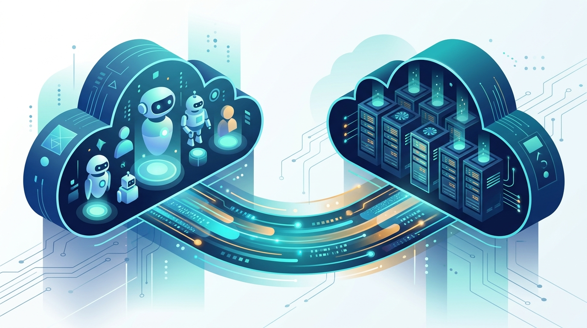

Si hace unos días te contábamos que OpenAI metió sus modelos en Google Cloud, ahora viene la contraparte: **Anthropic también amplió su presencia, y con una twist interesante**. Google Cloud anunció la disponibilidad general de una opción de despliegue **gestionada por Anthropic** para los modelos Claude, que se suma a la opción gestionada por Google que ya existía.

## ¿Dos Claudes? No exactamente

Los modelos son los mismos y llegan el **día cero en ambas modalidades**: Claude Fable 5.1, Sonnet 5.5 y compañía. El mismo pricing, la misma facturación de Google Cloud, y ambas opciones consumen tus compromisos de consumo (committed use discounts, para los amigos).

La diferencia real está en **quién actúa como procesador de datos** y qué features de plataforma tienes disponibles:

**Modo Anthropic-managed (el nuevo):**
- Anthropic opera el stack sobre infraestructura de Google Cloud, bajo sus términos comerciales
- Acceso inmediato a las features de Claude Platform: **Claude Managed Agents (beta)**, skills y code execution
- Autenticación con IAM de Google Cloud y Cloud Audit Logging
- Todo el gasto consolida en tu cuenta de Google Cloud

**Modo Google-managed (el de siempre):**
- Google Cloud es el procesador de datos, bajo tus contratos existentes
- Refuerzos de gobernanza: **VPC Service Controls, CMEK** (llaves de cifrado administradas por el cliente) y residencia de datos en US, EU y APAC
- Integraciones nativas con BigQuery y Model Armor
- Las features nuevas de Claude Platform llegan "cuando se integren" al stack de Google

## El patrón que se repite

Si te suena conocido, es porque es la misma jugada de todo el ecosistema: **las nubes se están convirtiendo en supermercados de modelos ajenos**. Google Cloud ya tiene Gemini, Claude, OpenAI y Llama en el Model Garden, y la diferenciación se juega cada vez más en gobernanza, soberanía de datos y facturación consolidada que en los modelos en sí.

Para los equipos con requisitos estrictos de compliance (banca, salud, sector público chileno y de la región), esta distinción de "quién procesa tus datos" no es un detalle menor: puede definir qué opción es viable contractualmente.

**Link original:** [Expanding Claude availability and deployment choice on Google Cloud](https://cloud.google.com/blog/products/ai-machine-learning/expanding-claude-availability-on-google-cloud)
