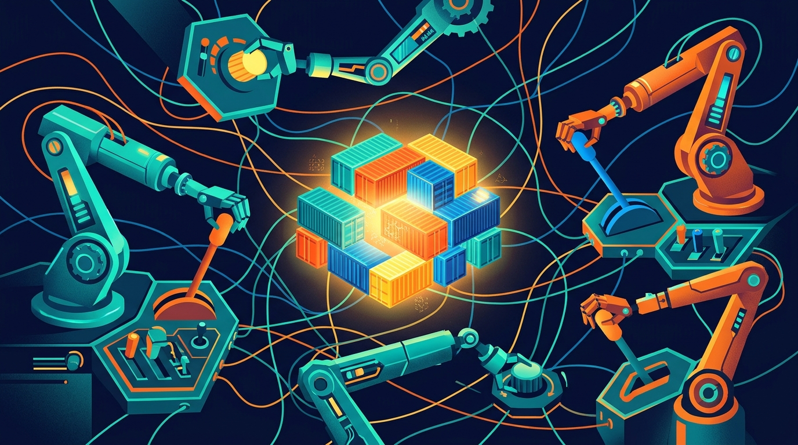

Pregunta simple para cualquier SRE: ¿cuántas réplicas debería tener `checkout-api` ahora? El Helm dice 3. El HPA, viendo la carga de CPU, subió a 11. El VPA insiste en que está sobreaprovisionado y recomienda bajar a 350m de CPU. KEDA, por un pico de lag en Kafka, exige 24 réplicas. Y Karpenter, en paralelo, ya aprovisionó dos nodos nuevos dimensionando contra los requests declarados, no contra el uso real.

**Cinco fuentes, cinco respuestas contradictorias.** Cada controlador actúa con lógica en aislamiento, pero ninguno ve el cuadro completo. Esa es la tesis de un análisis de The New Stack publicado hoy, y pega duro porque describe algo que cualquier equipo de plataforma que opera Kubernetes en producción ya vivió en carne propia.

## La filosofía Unix se rompe en sistemas elásticos

Kubernetes se construyó sobre la idea de herramientas pequeñas que hacen una cosa bien: HPA para elasticidad horizontal, VPA para sizing vertical, KEDA para colas de eventos, Karpenter y Cluster Autoscaler para capacidad de nodos, GitOps para el estado base. El problema es que en Unix los pipes son **secuenciales** — uno termina y le pasa el output al siguiente. Los autoscalers, en cambio, ejecutan **en paralelo**, mutando los mismos campos de API (`.spec.replicas`, `.resources.requests`, el node pool) desde loops de reconciliación independientes que asumen control exclusivo.

Como resume el artículo: determinar la capacidad de un workload es **una sola ecuación matemática acoplada**. Repartirla entre controladores desacoplados genera thrashing, no eficiencia modular.

## Las cuatro colisiones clásicas

**1. Colapso del denominador — HPA vs. VPA.** El HPA calcula utilización como porcentaje de los requests declarados. Si el VPA baja esos requests para eliminar desperdicio, se encoge el denominador: un alza menor de tráfico dispara un scale-out horizontal agresivo. Más pods reparten el tráfico, el uso por pod baja, el VPA achica aún más los requests. **Espiral de muerte**: pod microscópico tras otro en una flota ingobernable.

**2. Carrera de múltiples escritores — HPA vs. KEDA.** Ambos terminan apuntando al mismo sub-recurso `/scale` del deployment. KEDA sube réplicas para drenar la cola; si los workers son I/O-bound con poca CPU, el HPA nativo concluye que sobra capacidad y baja las réplicas. El API server registra rescale events alternados mientras el throughput real se estanca.

**3. Ping-pong de drift — GitOps vs. runtime.** Cuando el HPA escala en un pico, Argo CD marca la app como `OutOfSync`. Con auto-sync activado, GitOps **resetea el deployment a la línea base en pleno pico**, quitándole capacidad justo cuando más la necesita. La workaround clásica —ignorar réplicas en el sync— rompe el declarativo: Git deja de reflejar la realidad.

**4. Efecto multiplicador en nodos — Karpenter.** Los autoscalers de nodo dimensionan contra los **requests declarados**, no contra el consumo real. Un contenedor que pide 1000m y usa 150m igual reserva el core completo. Karpenter compra instancias para demanda fantasma, multiplicando el sobreaprovisionamiento upstream en boletas gordas. El dato brutal del artículo: la utilización promedio de CPU en clusters de producción ronda el **8%**.

## El camino: de automatizado a autónomo

La distinción clave del artículo: los autoscalers actuales son **automatizados, no autónomos**. Son reflejos biológicos — miden una señal aislada y disparan una respuesta predefinida. Pero los reflejos no tienen sistema nervioso central: cuando cinco reflejos independientes se disparan sobre el mismo músculo, el sistema convulsiona.

La propuesta es un control plane unificado con cinco capacidades:

- **Ingesta unificada de señales**: CPU/memoria, profundidad de cola, SLOs de latencia, pricing de nodos y manifiestos IaC evaluados simultáneamente.
- **Decisión conjunta**: un solo vector de acción que define réplicas y requests en tándem, no repartidos entre herramientas.
- **Sync continuo con GitOps**: pull requests automatizados y razonados contra los repos, en vez de obligar a GitOps a ignorar el estado vivo.
- **Capacidad predictiva**: el scaling reactivo inherentemente llega tarde (iniciar compute toma tiempo); pre-calentar antes del tráfico convierte el scaling de reflejo de pánico en operación planificada.
- **Auditoría explicable**: cada ajuste con su racional operativo, para que el SRE entienda el trade-off entre costo, demanda y latencia.

La filosofía Unix sigue siendo el blueprint correcto para la **capa de ejecución**: HPA, VPA, KEDA y Karpenter deberían seguir haciendo las mutaciones de API que saben hacer. Lo que falta es **la capa de inteligencia central que decide qué deben hacer esos actuadores**.

La pregunta para tu equipo de plataforma no es "¿HPA o VPA?", sino: **¿quién decide el tamaño de este workload, y tiene el cuadro completo?** En los clusters modernos, hoy la respuesta es: nadie.

*Contexto extra: esta pieza llega en la misma semana en que la conversación del ecosistema se centra en cómo los workloads de IA (jobs esperando mientras las GPUs están ociosas) exprimen aún más los límites del autoscaling de Kubernetes. La presión por autonomía no va a bajar.*

**Fuentes:** The New Stack (24 oct 2026), blog CNCF.
