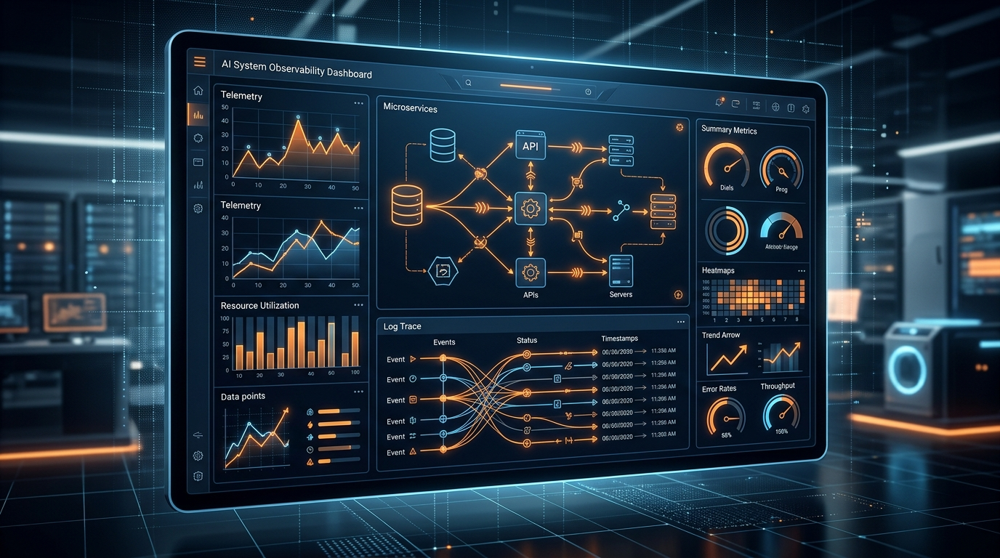

Evaluar la efectividad real de los modelos de lenguaje en tareas de infraestructura y SRE ha sido históricamente un terreno pantanoso. Para aportar métricas objetivas y neutrales, Grafana Labs presentó la versión **v1.1 de o11y-bench**, la suite de pruebas comparativas abierta diseñada específicamente para medir capacidades de IA en observabilidad.

Además, el proyecto acaba de integrarse oficialmente al **Specialized Intelligence Index** de Fireworks AI, convirtiéndose en el estándar de evaluación para modelos orientados a operaciones IT.

## ¿Qué evalúa o11y-bench v1.1?

A diferencia de los benchmarks genéricos (como MMLU o HumanEval), o11y-bench pone a prueba a los modelos en escenarios reales a los que se enfrenta un ingeniero de guardia (*on-call*):

* **Análisis de Causa Raíz (*Root Cause Analysis*):** capacidad de correlacionar métricas, trazas (*spans*) y logs durante un incidente simulado en producción.
* **Generación de consultas complejas:** traducción de lenguaje natural a sintaxis válida de PromQL, LogQL y TraceQL sin introducir alucinaciones.
* **Parsing y estructuración de logs:** extracción de campos clave a partir de registros desestructurados en tiempo real.

## Los hallazgos de la versión 1.1

Los datos de la versión 1.1 revelan que los modelos generalistas de gran tamaño no siempre son los mejores para tareas de SRE. Modelos más pequeños pero ajustados (*fine-tuned*) con datos de telemetría y documentación de OpenTelemetry logran una precisión equivalente en síntesis de alertas a una fracción de la latencia y del costo computacional.

Con esta alianza entre Grafana y Fireworks AI, las empresas ahora disponen de un tablero transparente para seleccionar el LLM adecuado antes de delegar la resolución de incidentes o el análisis de telemetría a agentes autónomos.

**Fuentes:** [Grafana Labs Blog](https://grafana.com/blog/evaluate-ai-models-for-observability-o11y-bench-joins-fireworks-specialized-intelligence-index-and-reaches-v1-1/), [Fireworks AI](https://fireworks.ai/).
