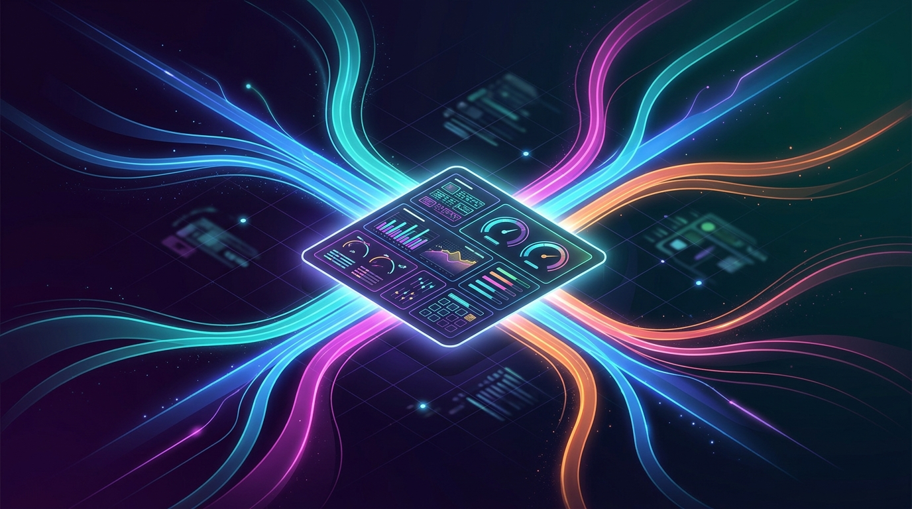

Dynatrace [expandió las opciones de ingest](https://www.dynatrace.com/news/blog/dynatrace-unifies-ai-observability-ingest-across-coding-agents-oneagent-and-openinference/) de su producto AI Observability, con un objetivo claro: que la telemetría de IA llegue por la puerta que sea, **sin forzar re-instrumentación**, y caiga normalizada en el mismo modelo de datos `gen_ai.*`.

## El problema: cada equipo instrumenta distinto

Un equipo de plataforma corre Claude Code y GitHub Copilot; otro tiene un servicio Python sobre AWS Bedrock; un tercero ya estandarizó en OpenInference porque su framework lo trae de fábrica. Cada stack produce telemetría en formato distinto y, por defecto, cada uno necesitaba su propio camino hacia la plataforma de observabilidad. La consecuencia típica: silos de visibilidad justo donde más falta hace.

## Las tres puertas nuevas

- **OneAgent para Python (GA):** instrumenta directamente aplicaciones LLM que usan AWS Bedrock, OpenAI, Azure OpenAI o LangChain. Es un setting, no un cambio de código: captura prompts, completions, latencia y costo de las llamadas a modelos, y las deja junto al resto de la telemetría de la app — una llamada a un LLM pasa a ser un span más en la traza, no un sistema aparte.
- **Sensores Python experimentales:** para Anthropic, OpenAI Agents, Google ADK, Claude Agent SDK, Microsoft Foundry, Mistral, LangChain/LangGraph, Pydantic AI, LiteLLM, Cohere, CrewAI, Groq, Haystack y Ollama. Se activan individualmente por feature controller, con la advertencia de que el esquema puede cambiar sin aviso.
- **OpenInference nativo:** la especificación que [Arize donó a OpenTelemetry](https://github.com/open-telemetry/community/issues/3467) (la fusión aterrizó a mediados de año) instrumenta 33+ frameworks sin tocar código. Dynatrace ahora ingiere esos spans tal cual, normalizando las convenciones de atributos a `gen_ai.*`. Si tu equipo ya instrumentó con OpenInference, eso funciona en Dynatrace sin modificación.

## Coding agents bajo la lupa

La pieza quizás más pertinente para líderes de ingeniería: agentes como Claude Code, Codex, Cursor, Google Antigravity o Copilot pasaron de experimento a herramienta diaria, y casi nadie puede responder qué agentes se usan realmente, cuánto cuestan o dónde fallan. Dynatrace agregó soporte para **Claude Managed Agents y Claude Platform tracing**, con export OpenTelemetry nativo desde la Claude Console — sin cambios de código — y quedó listado como partner de observabilidad en la plataforma de Anthropic.

## La lectura

Después de completar la compra de Arize, Dynatrace está apostando fuerte a que la observabilidad de IA es la siguiente battleground del mercado. La estrategia es la correcta en vez de pelear por imponer un estándar propio: **abrazar OpenInference/OTel como idioma común** y competir por lo que ocurre después del ingest — análisis, root cause a través de cadenas de agentes y herramientas, costo.

Para los equipos que ya viven en Dynatrace, esto reduce la fricción de adoptar visibilidad de IA. Para el resto, es otra señal de que 2027 será el año en que preguntar "¿cuánto cuesta y qué tan confiable es tu agente?" tendrá respuesta con datos y no con corazonadas.
