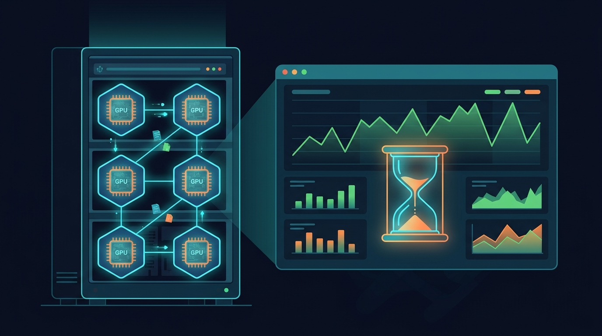

There's a classic deloperativo que The New Stack destapó esta semana en su serie sobre IA y Kubernetes: el equipo de operaciones celebra porque **"las GPUs están al 100%, estamos volando"**. Spoiler: eso no dice casi nada. Un clúster de Kubernetes puede estar totalmente sano mientras el modelo demora una eternidad en terminar una respuesta, o responde rápido pero con puras weás inútiles. La utilización de GPU es una señal, no un diagnóstico.

## El problema de fondo

El desafío operativo es conectar el **comportamiento del servicio de IA** (lo que experimenta el usuario) con las condiciones de Kubernetes, GPU, cómputo, almacenamiento y red que hay detrás. Ver cada capa aislada no alcanza. Una GPU ocupada no identifica el cuello de botella: puede ser el particionado de la GPU ("¿la partición es demasiado chica para ese modelo?"), la red, la base de datos vectorial, o simplemente que el mix de requests cambió y los modelos nuevos tienen otros perfiles de latencia.

## La receta: medir antes, comparar después

Lo que recomiendan los expertos de HPE (Marius Bogoevici, Mahesh Ramachandran y Karthik Subramanian):

- **Perfilar el sistema de serving antes de lanzar a producción**: prompts representativos, longitudes de contexto, volúmenes de salida y niveles de tráfico reales.
- **Métricas de experiencia, no solo de infra**: time to first token, time per output token, latencia inter-token, tiempo a respuesta completa, confiabilidad, capacidad, costo y —crítico— **calidad de respuesta**. Un primer token rapidísimo puede enmascarar una generación lentísima después.
- **Documentar dónde se mide cada intervalo** y comparar bajo carga sostenida y picos, no solo en condiciones de laboratorio.
- **La calidad merece su propia evaluación**: la telemetría de plataforma muestra que el request fue servido, pero no si la respuesta fue buena o una alucinación. Eso requiere criterios de aceptación y tests con datos representativos.

## Autoscaling: CPU no sirve como disparador

Detalle práctico que varios se saltan: el Horizontal Pod Autoscaler de Kubernetes soporta **métricas custom y externas**, así que no hay que reemplazarlo porque la utilización de CPU sea un pésimo trigger para inferencia. Lo que sí hay que hacer: provisionar y probar el pipeline de métricas, los límites de scaling y la capacidad real de aceleradores disponible. Spoiler 2: una política de scaling no hace aparecer GPUs de la nada.

La discusión completa, con el contexto de HPE Morpheus y OpsRamp para gestión de plataforma híbrida, está en [The New Stack](https://thenewstack.io/ai-inference-kubernetes-observability/). Moraleja para el equipo de plataforma: verde en el dashboard ≠ usuarios felices. Hagan baseline antes de que el incidente los obligue.
