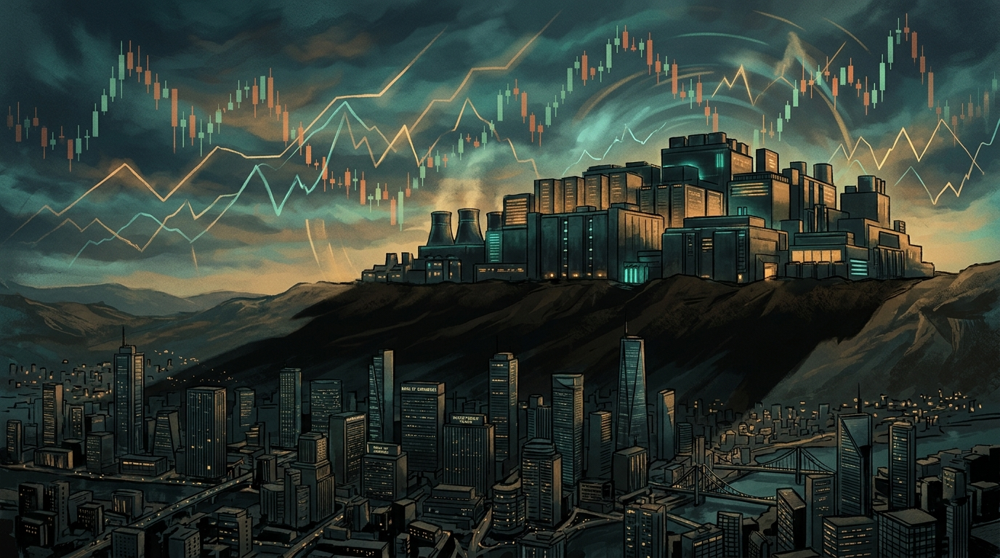

El 31 de octubre el WSJ publicó un dato que resume el ánimo del mercado hacia la fiebre de la IA: el costo de **asegurar contra default la deuda de los cinco hyperscalers — Amazon, Alphabet, Microsoft, Meta y Oracle — llegó a su nivel más alto desde 2021**, según datos de Solve. El diario califica el build-out de IA como *"la mayor apuesta de mercado de la historia"*. Y cuando el mercado de crédito empieza a moverse, hay que prestarle atención.

## Los números

- **Oracle**: su CDS a cinco años ronda los **~288 puntos básicos**, cerca de récord, más de un punto porcentual más caro que hace un mes. Los traders ya lo llaman el *AI hyperscaler default trade*.
- **Meta ~108 bps** y **Nvidia ~101 bps** también en máximos relativos.
- Las empresas ligadas a IA han emitido **~US$466.000 millones en deuda este año**.
- JPMorgan Private Bank contabiliza **US$266.000 millones de emisión de bonos ligada a IA en 2026**, contra US$139.000 millones en todo 2025 y US$29.000 millones en 2024. La curva es vertical.
- Goldman calculó el techo teórico: unos **US$510.000 millones** de deuda investment grade disponible para los hyperscalers más grandes. Es mucho, pero ya no es infinito.
- El color del año: hasta **Alphabet emitió un bono a 100 años**.

## Por qué debería importarte si tu trabajo es cloud

Esto no es solo color de página de economía. La cadena es directa:

1. Los data centers que corren nuestros clusters y nuestras cargas de inferencia **se financian con deuda**, no solo con caja.
2. Si la prima de riesgo sigue subiendo, **emitir se encarece**, y con eso se frena o re-escala el build-out.
3. Menos capacidad futura o más cara = **presión sobre precios de compute en 2027**, disponibilidad de GPUs y SLAs.

Ya lo veníamos siguiendo: [el capex de la IA como burbuja de concentración](/posts/2026-08-11-ai-capex-burbuja-concentracion-cloud/) y la advertencia de Moody's sobre el riesgo de crédito de los [hyperscalers](/posts/2026-07-26-moodys-785b-capex-ai-credit-risk-hyperscalers/). Lo nuevo es que la señal ya no es una proyección de analista: **está cotizando** en el mercado de CDS.

## La lectura pragmática

Nadie está diciendo que Amazon vaya a caer en default — un CDS de 108 bps sigue siendo nivel de empresa sólida. El punto es la **dirección y la velocidad**: el mercado de crédito pasó de mirar la fiesta de capex con indulgencia a cobrarle prima. Para los equipos de plataforma y FinOps, el consejo práctico es simple: si tu roadmap 2027 depende de capacidad cloud barata y abundante, considera que ese descuento ya no está garantizado. Diversificar regions y providers, y presupuestar con inflación de compute, dejó de ser pesimismo y pasó a ser gestión de riesgo.

**Fuentes:** [WSJ vía AI Weekly](https://aiweekly.co/alerts/wsj-cds-on-amazon-alphabet-microsoft-meta-and-oracle-debt-hit-highest-since), [CNN Business](https://www.cnn.com/2026/10/30/business/ai-stocks-bonds-debt), [The Business Times](https://www.businesstimes.com.sg/opinion-features/ai-frenzy-gets-reality-check).
