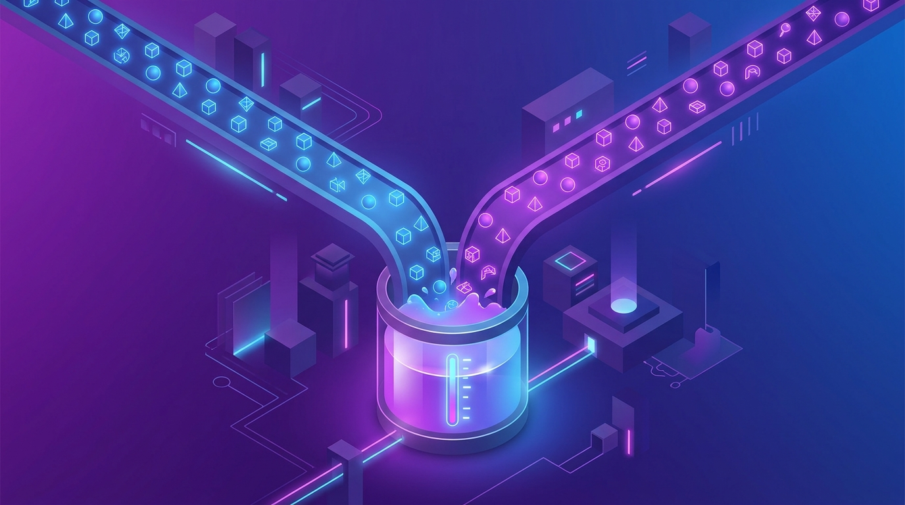

OpenAI confirmó el 31 de octubre un cambio que va a reordenar cómo varios equipos usan sus suscripciones: **desde diciembre, ChatGPT y Codex consumirán de un único pool compartido de tokens** para los planes Plus, Pro y Business, reemplazando los presupuestos separados por producto que existen hoy.

## El cambio en concreto

- Un solo **allowance basado en tokens** para chat y coding en la misma suscripción.
- Es la continuación lógica del giro de abril, cuando OpenAI movió sus planes a **créditos por token** en vez de límites difusos por "mensajes".
- Los planes **Pro mantienen su distinción** de no estar sujetos al límite de 5 horas.
- La reacción no se hizo esperar: r/OpenAI se llenó de threads de "allowance enforcement" y Hacker News marcó la actualización del help center con 164 puntos.

## Por qué importa

Hasta ahora, muchos equipos trataban ChatGPT y Codex como presupuestos independientes: podías quemar el mes entero de coding en Codex sin tocar tu cupo de chat, o viceversa. Con el pool unificado eso se acabó: **una sesión pesada de Codex te deja seco para el chat del lunes**, y al revés. Para quien usa Codex como herramienta principal de desarrollo, el presupuesto compartido convierte el uso casual de ChatGPT en un costo de oportunidad real.

## Lectura práctica

- Si administras suscripciones de equipo, **revisa los patrones de uso antes de diciembre**: quienes concentran todo en Codex son los más afectados.
- El monitoreo del usage deja de ser opcional — con un solo pool, la visibilidad de consumo por herramienta es lo que va a evitar sorpresas a mitad de mes.
- Y el incentivo económico es claro: OpenAI quiere que el que se queda corto en un producto suba de plan en vez de racionar dos colas separadas. Sutil, pero es exactamente el efecto de consolidar los presupuestos.

Cambio pequeño en apariencia, grande en el día a día de quienes viven entre el chat y el agente de código.

**Fuentes:** [AI Weekly — AI News Today, 1 de noviembre](https://aiweekly.co/ai-news-today), [Crypto Briefing](https://cryptobriefing.com/openai-unifies-chatgpt-codex-token-allowance/).
