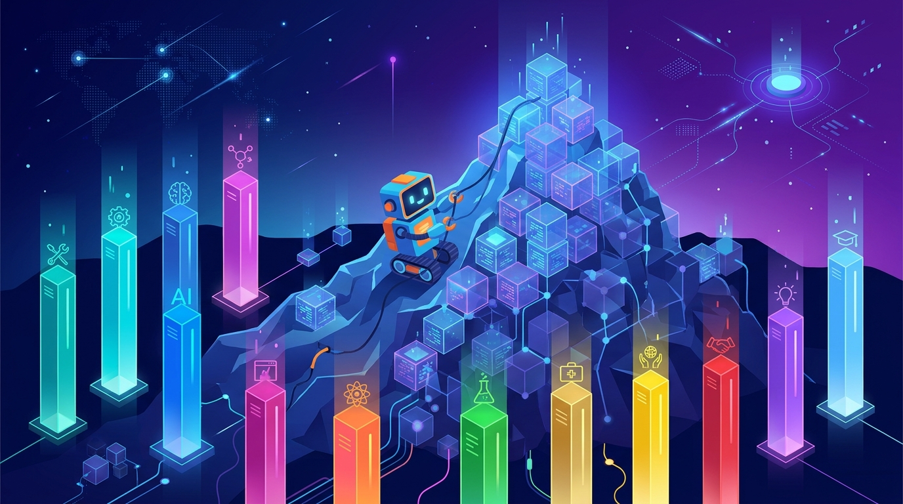

SemiAnalysis publicó hoy **GDPx**, un benchmark de capacidades agénticas generales que apunta donde los benchmarks tradicionales ya no llegan. La cifra que define el lanzamiento: **Claude Opus 5.5 lidera el leaderboard debut con un 12,0%**. Cuando el mejor modelo del mundo resuelve apenas 12% de las tareas, el benchmark está midiendo la frontera de verdad.

## Qué es GDPx

- **206 tareas** construidas con **14 partners especializados**, abarcando **11 dominios**: diseño de chips, ciberseguridad, biología, finanzas, legal, trading cuantitativo, auto-mejora recursiva (RSI), diseño de hardware, ciencia de materiales, alignment y software engineering.
- Cada tarea vive en un **entorno realista** e interactivo, con límite de tiempo por defecto de **8 horas**.
- Los modelos corren en su **harness nativo** cuando existe: Claude Code para Opus 5.5, Codex para GPT-6 Astra, Antigravity para Gemini 4 Carbon. Fallback: OpenCode.

El ejemplo de finanzas da la medida del realismo: las 24 tareas de ese dominio replican una transacción de private equity completa — un fondo compra ~62% de un fabricante de snacks por US$880 millones más earnout — reconstruida en **~4.000 archivos anonimizados**. Nada de contexto servido en bandeja.

## El leaderboard V1.0

| Modelo | Puntaje | Costo por tarea |
|---|---|---|
| Claude Opus 5.5 | 12,0% | US$51,41 |
| Gemini 4 Carbon | 10,9% | US$16,29 |
| GPT-6 Astra | 9,6% | US$53,99 |
| Meta Muse Wonder Full | 9,0% | sin precio público |
| ... | ... | ... |
| GLM-5.3 (Z.ai) | 2,7% | — (posición 13) |

Detalles metodológicos: el puntaje promedia pass@1 en tres intentos, pondera todos los dominios por igual y aplica el método de grading propio de cada tarea (binario o continuo). Claude Opus 5.5 gana en quant trading, hardware y diseño de chips; Gemini 4 Carbon se lleva biología y software engineering por poco; GPT-6 Astra domina RSI y materiales. Y el costo importa: Gemini 4 Carbon cuesta un tercio de lo que cuesta Opus por tarea.

## Por qué existió que existir

GDPx llega como sucesor crítico de **GDPval de OpenAI** (el benchmark de uso general más citado en las model cards). Los reproches de SemiAnalysis: tareas no interactivas con todo el contexto "servido en cuchara" en el prompt y un acuerdo inter-rater humano de apenas 71% en su subset dorado. Más duro aún: el mismo proceso de QA que SemiAnalysis exigió a sus partners **marca cerca del 50% de las tareas de Terminal Bench 4.0 como rotas**.

## La lectura práctica

Para quien elige modelos para flujos agénticos en producción, GDPx apunta a ser una señal más honesta: entornos persistentes, horizontes largos y tareas donde el modelo tiene que buscar su propio contexto. El puntaje bajo de todos — de 2,7% a 12% — dice que el hype agéntico sigue muy adelantado respecto de la capacidad real. Útil recordatorio antes de asignarle a un agente algo crítico y cruzarse de brazos.

Fuentes: SemiAnalysis (GDPx announcement), Unite.AI.
