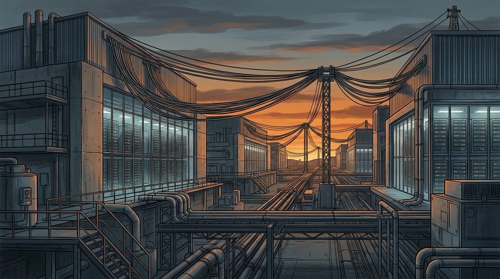

La fiesta de los neoclouds tiene música cada vez más baja. Según un reportaje de **Bloomberg**, **Microsoft estaría desencantado con los operadores emergentes de data centers** — IREN, Nebius y Nscale entre los señalados — por retrasos y costos que no calzan con lo prometido. La ironía es evidente: fue el propio Microsoft el que ayudó a crear el boom, firmando **decenas de miles de millones de dólares en contratos** con operadores novatos para saciar el apetito voraz de Azure por cómputo de IA.

## IREN puso los números sobre la mesa

La earnings de IREN (FY Q1 2027, reportada el 5 de noviembre) confirmó la tensión:

- Ingresos de **US$228 millones**, +66% respecto al trimestre anterior y por sobre el consenso de US$221M.
- **AI Cloud más que se duplicó**, a US$200 millones.
- Pero hay un globo flotando: **US$4.000 millones en ingresos anualizados quedan retrasados por pedido del cliente** (léase: el mayor de ellos, Microsoft).

¿El motivo del retraso? El cliente pidió **reconfigurar y hacer upgrade de la infraestructura de red** para habilitar 200 MW de capacidad dedicada a **modelos frontier de última generación**. Traducción: la generación anterior de GPU ya no es la prioridad; los nuevos modelos exigen otro tejido de red, y mientras eso se instala, la plata no entra.

La acción venía con **-55% en el último mes** antes del reporte, aunque rebotó en horario extendido tras los números.

## El contexto más grande

Esto no es un caso aislado, es un patrón que llevamos semanas viendo:

- **Oracle canceló arriendos de chips a Tencent** para priorizar a sus clientes con más margen (lo cubrimos el 4 de noviembre).
- La deuda de los hyperscalers anda en niveles máximos desde 2021, apalancados para construir capacidad de IA (1 de noviembre).
- Anthropic comprometió cerca de **US$900.000 millones** en cómputo e infraestructura futura, según recopiló The Verge tras las earnings de Q3 del Big Tech.

## Por qué importa

El mensaje para cualquiera planificando capacidad: **la era del "cualquier DC con GPU sirve" se acabó**. Cuando el cuello de botella migra del chip a la red que conecta miles de chips, los contratos se renegocian, los timelines se estiran y los neoclouds más apalancados quedan expuestos. Si tu estrategia cloud depende de capacidad reservada en operadores chicos, conviene tener plan B — o al menos, cláusulas de salida bien redactadas.
