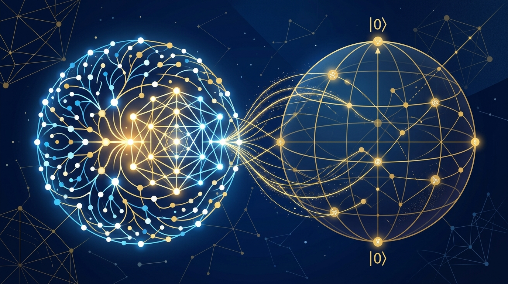

La semana cerró con una de esas noticias que hacen levantar la ceja hasta al más escéptico: **Physical Superintelligence (PSI)**, una startup de investigación acelerada por IA, anunció el viernes que su sistema interno —corriendo instancias de un **modelo no publicado de Anthropic**— encontró una **prueba completa de la conjetura de Aaronson-Ambainis**, un problema de teoría de la computación cuántica abierto desde 2008.

## Qué dice la conjetura, en criollo

Scott Aaronson y Andris Ambainis plantearon en 2008 una pregunta central: ¿cuándo puede una computadora cuántica superar exponencialmente a una clásica? Su conjetura conectaba esa pregunta con un enunciado sobre polinomios: si era verdadera, significaba que una máquina clásica podía predecir el comportamiento de un algoritmo cuántico con pocos accesos al input.

La prueba, publicada en un [paper de David Turturean en GitHub](https://github.com/physical-superintelligence/aaronson-ambainis/blob/main/paper/aaronson_ambainis_paper.pdf), establece el resultado: **para computaciones de sí/no, un algoritmo clásico puede aproximar la probabilidad de respuesta de un algoritmo cuántico en la mayoría de los inputs aleatorios, sin necesitar exponencialmente más accesos**. Traducción: las ventajas cuánticas exponenciales requieren estructura. No hay atajos mágicos en datos desordenados.

## Lo que lo hace distinto de un "Claude escribió una demo"

Tres detalles levantan el nivel de esta noticia:

1. **Formalización en Lean**: el teorema principal y la formulación de la conjetura original fueron verificados por el kernel de Lean, el proof assistant que revisa cada paso lógico mecánicamente. No es un "confía en mí".
2. **Revisión humana**: además del chequeo automático, investigadores revisaron el trabajo.
3. **El tiempo**: el sistema encontró la prueba completa **durante el tercer día de corrida**. Un problema de 18 años, tres días de compute.

PSI lo resumió así: "settling one of the most fundamental questions in quantum computing. Quantum computing still has plenty of mysteries, but now there is one fewer."

## Matices importantes

- El teorema **limita accesos al input, no el tiempo total de cómputo**. No cierra la puerta a ventajas cuánticas prácticas en problemas con estructura — de hecho, le da base teórica más firme a buscar speedups donde la estructura del problema ayude.
- El modelo es **no público**: no hay paper del modelo ni detalles de qué es exactamente. La fe en "un modelo de Anthropic que nadie más puede usar" es parte del combo.
- Llega en una semana donde los resultados matemáticos generados por IA se están acumulando, con anuncios paralelos de OpenAI apuntando en direcciones similares.

## Por qué importa para el que construye software

Más allá de la física, la señal es de infraestructura: **los sistemas de investigación autónomos con verificación formal (Lean) ya no son paperware**. La combinación modelo frontera + proof assistant + orquestación de corridas largas es exactamente el patrón que las plataformas de agentes están habilitando — y esta vez el output fue un teorema que aguantó el chequeo.

**Lectura rápida**: IA probando teoremas verificables pasó de demo a resultado publicable. El siguiente que te diga que los agentes "solo escriben código boilerplate", cuéntale esta.
