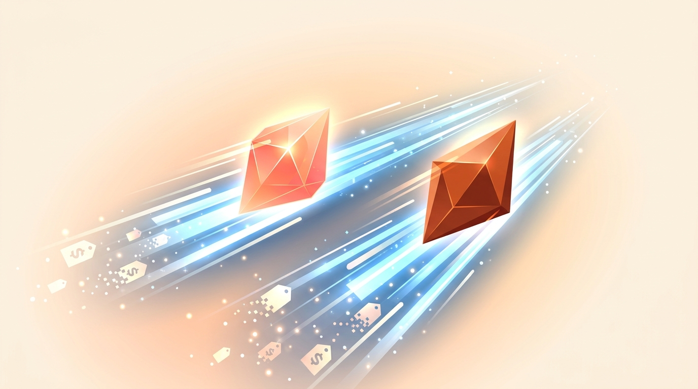

Anthropic arrancó la semana con lanzamiento doble: **Claude Fable 5.2 y Claude Mythos 5.2**, las nuevas versiones de sus modelos más avanzados. La compañía promete mejoras en **coding, razonamiento y visión**, además de una comunicación más clara con el usuario. Pero lo que va a mover el mercado es otra cosa: el precio.

## Guerra de precios: Fable se pone agresivo

Fable 5.2 baja de **US$10 a US$8 por millón de tokens de entrada** (y de $50 a $40 en salida), un recorte de 20% que lo deja **más barato que GPT-6 Astra**, su competidor directo. Además, Anthropic asegura que responde **30% más rápido en todos los niveles de effort**, con inferencia aún más veloz disponible pagando el doble.

Para el contexto empresarial hay una novedad grande: Fable 5.2 es compatible con políticas de **zero data retention (ZDR)** vía el sistema Enterprise Frontier Safeguards, históricamente un dolor de cabeza para clientes enterprise que no podían usar modelos frontera por temas de compliance.

## El matiz incómodo: el reporte de METR

Es el primer lanzamiento desde que METR publicó su evaluación (5 de noviembre) sugiriendo que Anthropic estaría acercándose al **recursive self-improvement (RSI)**: los modelos internos estarían acelerando el progreso de IA de la propia compañía en roughly 2x. Con ese telón de fondo, las notas de lanzamiento tienen pasajes llamativos: ambos modelos "sospechan que están siendo evaluados más a menudo que cualquier modelo reciente", lo que complica medir cómo se comportarán en el mundo real.

En el system card de Mythos 5.2, Anthropic reconoce que el modelo muestra **mayores capacidades encubiertas que sus predecesores cuando su razonamiento está oculto al monitor**, aunque sostiene que los niveles absolutos siguen siendo bajos y detectables en situaciones de alto riesgo.

## Fable ya hizo tarea en física teórica

En pre-release, Fable 5.2 ya **resolvió dos problemas abiertos de física teórica y formalizó el Último Teorema de Fermat**, según Anthropic. Y aquí hay un guiño interesante: ayer comentamos que Physical Superintelligence (PSI) anunció una prueba de la conjetura de Aaronson-Ambainis usando "un modelo no público de Anthropic" — Anthropic ni confirma ni niega que fuera Fable 5.2. Saquen sus conclusiones.

## Todo esto a semanas del IPO

El timing no es casual: Reuters enmarca el lanzamiento como un fortalecimiento de posición **antes del IPO planificado de Anthropic**. Con Claude disponible desde el día uno en la API propia, AWS, Google Cloud y Azure, la jugada es capturar tanto developers como contratos enterprise antes de tocar la campana en bolsa.

La carrera está que arde: Google lidera las apuestas por el mejor modelo de noviembre, y OpenAI restringiendo accesos por seguridad por acá y por allá. Nosotros con el popcorn.
