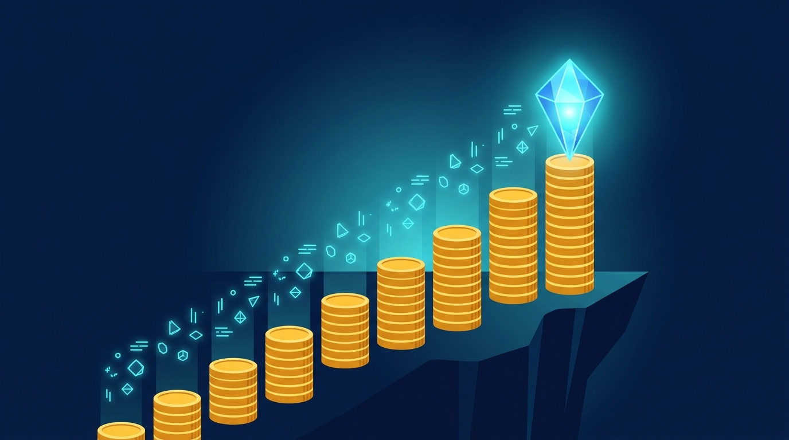

Google largó **Gemini 4 Argon** con una tarifa introductoria que few leyeron con atención: **US$2 por millón de tokens de entrada y US$10 por millón de salida**, con input cacheado a 95% de descuento. El detalle que importa: **esa tarifa expira el 30 de noviembre**. Desde el 1 de diciembre rige la estándar: **US$4 y US$20**. Misma carga, cuenta duplicada.

Trabajo que cuesta US$500 este mes cuesta US$1.000 en diciembre a volúmenes idénticos de tokens. Y como los presupuestos del año se están cerrando justo ahora, el timing no es casualidad: un modelo frontera a mitad de precio durante la temporada de pilotos captura el slot de piloto, y el slot de piloto define el contrato de producción del año siguiente.

## Los números, sin adorno

- **Intro (hasta 30 nov)**: $2/M input, $10/M output, cache con 95% off
- **Estándar (desde 1 dic)**: $4/M input, $20/M output
- **Todo combina se duplica**: análisis de documentos (80% input / 20% output) pasa de $3,60 a $7,20 por millón blendado; generación de código (60/40) de $5,20 a $10,40; chat (95/5) de $2,40 a $4,80
- **El leverage real es el cacheo**: una sesión agéntica de código relee contexto en cada turno. Con 95% off en la porción cacheada (system prompts, definiciones de tools, archivos del repo), el descuento efectivo puede pesar más que la mitad de precio del headline

## Qué es Argon (más allá del precio)

El posicionamiento es deliberadamente angosto: **trabajo de conocimiento largo, multi-paso y de alta precisión**, no chat general. Documentos largos mezclando texto, tablas e imágenes convertidos en un output fundamentado; análisis de datos en el tiempo; borradores legales y financieros que sobreviven a una revisión.

Lo que un comprador enterprise debería notar: el entrenamiento conductamental. Google dice que Argon fue entrenado para respetar límites de sistema, **reportar hallazgos negativos honestamente** y pedir confirmación antes de pasos irreversibles. Un modelo que admite "no lo encontré" vale más que uno que rellena el hueco con texto plausible — lo más cercano a un audit trail que un modelo puede ofrecer.

Los benchmarks que anclan el lanzamiento: lidera el **Vals Index** (impacto económico en trabajo de finanzas, código, legal y tributario, que mide entregables y no respuestas de examen), la **Legal Agent Benchmark de Harvey** con buena fidelidad de citas (el no-negociable del rubro legal), y ServiceNow reportó **~20% más éxito de tareas** sobre Gemini 3.8 Flash en acceso temprano. Google también presume resultados internos: un refactor en Chromium, optimizaciones en su ADK y reducción de rollbacks — claims verificables que apuntan a código agéntico.

Disponible vía API (`gemini-4-argon`), AI Studio, Google Antigravity y el canal enterprise de siempre.

## Planificación para no llevarse la sorpresa

1. **Mide tu ratio input/output real** esta semana. Tu diciembre es tu noviembre × 2, exactamente.
2. **Activa cacheo explícito** para contexto estable (repos, system prompts, tool definitions). Es el mayor descuento disponible y Google lo diseñó esperando que sea el default, no una optimización de nicho.
3. **Decide qué carga justifica frontier y cuál no**. El patrón sano: prototipar con Argon, mover a Flash lo que quedó probado, y reservar Argon para lo que de verdad necesita precisión.
4. **Cierra los números del contrato antes del 30**. El pricing de listado de diciembre no va a negociarse solo.

**Lectura rápida**: el precio introductorio de Gemini 4 Argon no es un regalo, es un anzuelo con fecha. Si estás construyendo encima, haz las cuentas esta semana — porque el 1 de diciembre la cuenta se duplica sola.
