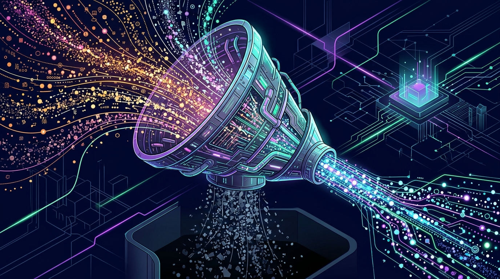

Aprovechando el ruido mediático de KubeCon NA 2026, **Cribl anunció la adquisición de Tero**, una startup que construye una capa de inteligencia sobre los datos de observabilidad. Si el nombre de Cribl te suena es porque son los de la "AI platform for telemetry": el motor que muchas empresas usan para colectar, rutar y optimizar sus logs, métricas y traces.

## El problema que resuelve: pagas por datos que no sirven

La gracia de Tero es su enfoque poco sexy pero brutalmente práctico: **medir cuánta de la telemetría de una organización es desperdicio**. Su tecnología detecta los datos de bajo valor acumulándose en tus herramientas de observabilidad y deja a los ingenieros arreglarlo **desde las herramientas que ya usan**, sin migraciones ni cambios de workflow.

Con los costos de observabilidad por las nubes (literalmente), saber qué telemetría no aporta nada es plata limpia. No es casualidad que venga ganando espacio: la factura del stack de monitoreo se volvió el grito silencioso de cada equipo SRE.

## El roadmap que viene

El equipo de Tero aterrizza en Cribl para liderar cuatro frentes: **host monitoring, APM, observabilidad federada y observabilidad AI-nativa**, todo sobre la misma plataforma abierta que los clientes de Cribl ya usan para su telemetría.

La frase de Clint Sharp, cofundador y CEO de Cribl, deja la estrategia a la vista: los mejores constructores de observabilidad están eligiendo construir con Cribl, para ingenieros **"y los agentes de IA que trabajan a su lado"**. Sí: la idea es que la misma plataforma que ordena tus datos también sirva para que los agentes de IA hagan sentido de ellos.

## El contexto: observabilidad en modo adquisición

El movimiento no es aislado. La industria va camino de consolidar: hace una semana CrowdStrike anunció la compra de Fiddler para observabilidad de agentes de IA, y los grandes (Datadog, Dynatrace, Grafana) siguen integrando IA por todos lados. La diferencia de Cribl es el ángulo: en vez de más dashboards, **atacar el costo y el ruido desde los datos mismos**.

Si tu facturita de observabilidad te tiene amargado, esta noticia es una señal de que la categoría se está tomando en serio el problema. Ahora, a esperar que la integración llegue pronto a la plataforma — y que los precios no sigan la dirección contraria.
