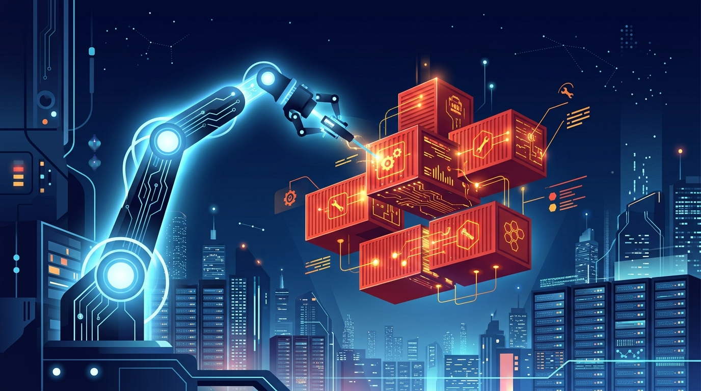

Si tu equipo opera OpenShift, atento: Red Hat anunció la disponibilidad general de **OpenShift 5** en el KubeCon + CloudNativeCon NA de Salt Lake City, y es el **primer salto de versión mayor en siete años**. No es un refresh cosmético: cambia cómo se opera la plataforma.

## El cambio de fondo: Lightspeed ahora es un agente

OpenShift Lightspeed, que hasta ahora era un asistente conversacional al que le preguntabas cosas, se convirtió en un **agente que hace trabajo real**:

- **Aísla anomalías y analiza streams de logs** sin que salgas de la consola.
- Ejecuta **remediación supervisada**: propone y aplica arreglos, pero con el humano mirando.
- Corre **pre-flight checks antes de los upgrades**, revisando compatibilidad de APIs y el riesgo de operadores opcionales. Red Hat le llama reducir la "ansiedad de upgrade", y cualquiera que haya vivido un upgrade de OpenShift con operadores de terceros sabe de qué hablan.

Además, OpenShift 5 agrega **soporte de servidores MCP (Model Context Protocol)** e interfaces de IA para los flujos headless/agénticos que vienen llegando a las plataformas. En ROSA (OpenShift Service on AWS), las respuestas de Lightspeed se anclan a la documentación oficial de OpenShift y de AWS: le preguntas "¿por qué falla este deployment?" y te da pasos de remediación con respaldo documental.

## Seguridad post-cuántica y soberanía

Para entornos regulados, air-gapped y edge:

- **Criptografía post-cuántica** en las comunicaciones del control plane, para blindarse contra "harvest now, decrypt later".
- Aislamiento multi-tenant endurecido y gestión de certificados extendida.
- Soporte nativo de deployments desconectados.

## Un ciclo de vida que por fin se puede planificar

Esto es lo que más va a importar en las áreas de arquitectura:

- El ciclo estándar por versión sube de **18 a 24 meses**.
- Desde la 5.2, **cada tercera versión será una release ELC (Extended Life Cycle)** con hasta 3 años extra de soporte: **cinco años en total**. Reemplaza el esquema EUS.

Ashesh Badani, CPO de Red Hat, resumió la apuesta: VMs, contenedores y IA agéntica corriendo lado a lado "con confianza total" en el hybrid cloud.

## Lo demás que trae

- **GPU slicing** para subir la utilización de hardware entre inferencia y workloads tradicionales.
- Pipelines de build más apretados basados en GitOps y gestión de OpenShift Virtualization.
- Y lo mejor para los clientes actuales: **upgrade in-place desde OpenShift 4**, sin migración. Disponible ya para suscriptores existentes en el Customer Portal.

## El contexto

El lanzamiento calza justo con la conversación dominante de este KubeCon: los agentes de IA operando infraestructura. Mientras la CNCF discute cómo identificar qué agente hizo qué en un cluster, Red Hat apuesta a que la respuesta comercial es un agente propio, supervisado y anclado a la documentación. One New Zealand, que corre su núcleo 5G en la plataforma, ya habla de pasar "de mantenimiento manual a una experiencia interactiva guiada".

Veremos si el agente de Red Hat llega antes que los problemas de identidad agéntica que el ecosistema todavía no resuelve.
