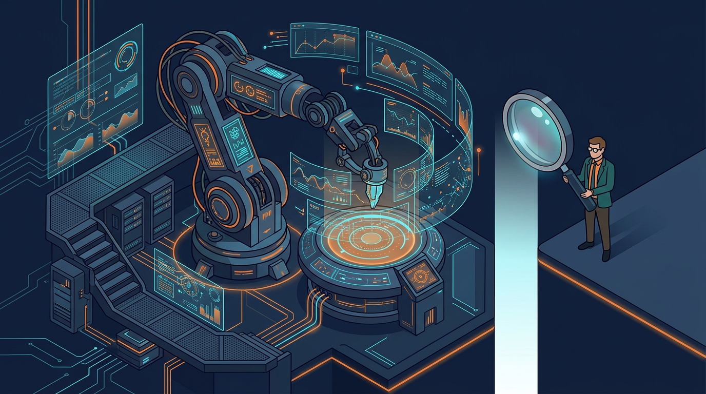

Dynatrace publicó su informe **State of Observability 2026** — encuesta a 1.202 líderes tecnológicos de empresas en 12 países, levantada en agosto — y el hallazgo central confirma una tensión que se venía barruntando: **las organizaciones están delegando operaciones en agentes de IA más rápido de lo que pueden verificarlos**.

## Los números que importan

- **87% ya usa agentes de IA** para observabilidad y operaciones IT
- **44% apunta a operaciones totalmente autónomas en cinco años**; hoy solo **12%** declara haber llegado a ese nivel
- Pero ojo: los humanos **verifican en promedio el 66% de las decisiones** tomadas por IA
- Y solo **27% tiene visibilidad real de cómo los agentes deciden y actúan**, aunque 43% considera esa visibilidad importante
- En nueve capacidades de observabilidad de IA medidas, **la ejecución queda en promedio 14 puntos por debajo de la importancia percibida**

## Plata y complejidad

La IA no solo promete ordenar el desorden: también lo está causando. El informe muestra que **43% cita la expansión de cargas IA/LLM/agénticas como fuente principal de complejidad** tecnológica, y el impacto financiero ya se siente:

- 78% espera que los presupuestos de observabilidad suban; en 96% de esos casos la adopción de IA es al menos un driver moderado
- 81% reporta mayor gasto en cómputo e infraestructura por cargas de IA
- 77% necesita más visibilidad para asignar costos correctamente

## OTel y seguridad, en vilo

- **OpenTelemetry**: 77% ya lo pasó de la fase de evaluación, pero solo **20% lo declaró estándar estratégico**. Adopción amplia, estandarización tímida
- 55% de los responsables de seguridad sufrió un incidente zero-day en el último año
- Solo 45% monitorea runtime de forma continua para vulnerabilidades realmente explotables — la diferencia entre "podría ser vulnerable" y "lo es, y afecta esto"

## El punto

Dynatrace resume la disyuntiva con dos conceptos que vale la pena memorizar: **observability of AI** (evidencia sobre el comportamiento de la IA) versus **AI-powered observability** (usar IA para operar mejor el stack). Las dos se necesitan; hoy el mercado tiene mucha de la segunda y poca de la primera.

La pregunta incómoda queda flotando: si tu agente toma una decisión operacional esta noche, ¿cómo sabes mañana qué hizo y por qué? Mientras esa respuesta siga siendo "no sé", la autonomía total sigue siendo presentación de ventas, no realidad operacional.
