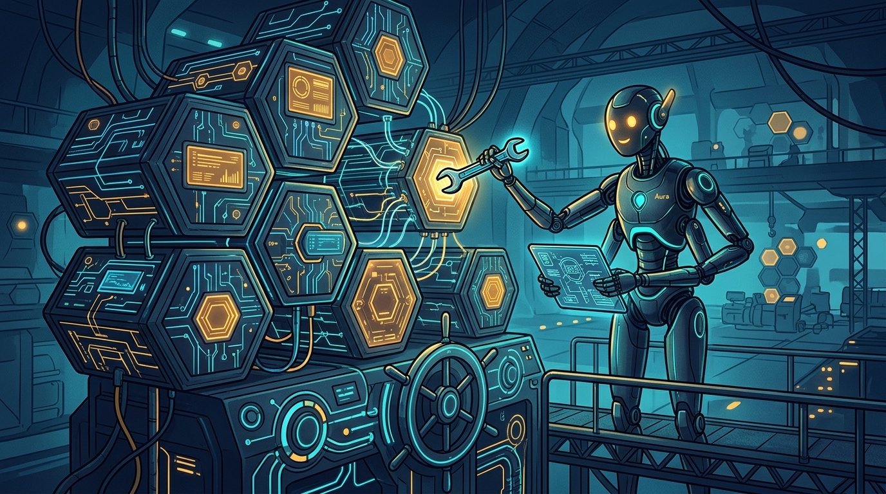

New Relic sacó a **public preview** el **Autopilot Kubernetes Agent**, un agente especializado que investiga incidentes en clusters, identifica la causa raíz y **genera el código de remediación** para que un ingeniero lo revise y ejecute. La apuesta: embeber IA agéntica directo en el flujo de trabajo del ingeniero, no en otra ventana de chat.

## Qué hace exactamente

- Corre **más de 90 detectores diagnósticos** sobre eventos de Kubernetes, descripciones de objetos, logs y trazas de APM
- Apunta a problemas de cómputo, fallos de scheduling, errores de red y configs cloud (Application Load Balancer, ingress, y compañía)
- Usa el **Ground Truth context engine**, construido sobre OpenTelemetry, para correlacionar la data operacional y proponer la causa probable
- El ingeniero mantiene el control: **revisión humana dentro de los workflows existentes** de SRE y platform engineering

Brian Emerson, Chief Product Officer de New Relic, lo resumió así: *"Cuando la infraestructura crítica de Kubernetes falla, los ingenieros necesitan respuestas claras, no más alertas."* Difícil discrepar.

## El contexto: el cuello de botella del conocimiento

New Relic cita investigación del CNCF según la cual **66% de las organizaciones que corren IA generativa dependen de Kubernetes**. La complejidad multi-cluster crece y, con ella, la dependencia de un puñado de especialistas que entienden el sistema completo. Cuando esa persona está de vacaciones y un pod se cae en cascada, el MTTR se estira.

El diagnóstico de New Relic es que los LLM genéricos no resuelven esto porque **no tienen acceso al contexto operativo del entorno vivo** — por eso el agente se alimenta de telemetría real vía OTel.

## Autonomía con cinturón de seguridad

Lo más interesante del posicionamiento: New Relic insiste en que esto es **decision support, no operador autónomo**. En Kubernetes, donde un cambio de configuración puede cascades por varios servicios, la revisión humana sigue al centro del incidente.

La coincidencia con el informe State of Observability 2026 que publicó Dynatrace esta misma semana no es casualidad: toda la industria quiere vender autonomía total, pero nadie se atreve a entregar las llaves sin supervisión. Los agentes que escriben el fix existen; el botón de ejecutar sigue siendo humano.
