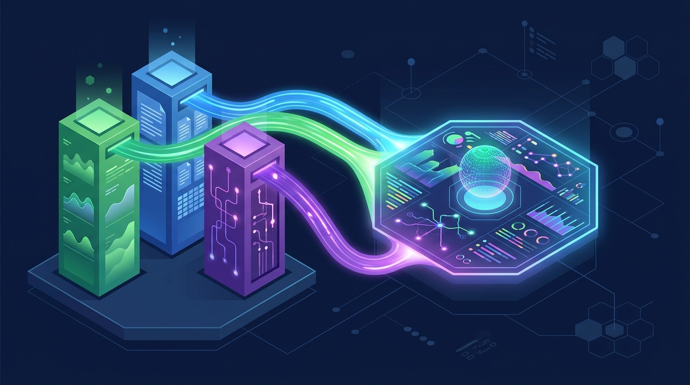

En pleno KubeCon + CloudNativeCon North America 2026, VictoriaMetrics sacó del horno **VictoriaStack**: un stack de observabilidad **open-source** que reúne a VictoriaMetrics (métricas), VictoriaLogs (logs) y VictoriaTraces (trazas) bajo un mismo paraguas. La idea es simple pero potente: darte la facilidad de un SaaS de observabilidad sin soltar el control ni el presupuesto de las herramientas self-managed.

## La apuesta: cada señal en su casa, no todo aplastado en una base de datos

La decisión de arquitectura clave de VictoriaStack es que **cada señal mantiene su propio motor de almacenamiento** en vez de forzar métricas, logs y traces a una única base de datos. Según la empresa, eso baja costos y respeta la naturaleza de cada tipo de dato. La coherencia entre las tres señales la entrega **OpenTelemetry (OTLP)** como protocolo compartido, lo que se agradece: menos glue code entre herramientas.

En el piso de la conferencia están demostrando una app Kubernetes instrumentada con OTLP que manda métricas a VictoriaMetrics, logs a VictoriaLogs y traces a VictoriaTraces, seguido de un flujo de troubleshooting cruzando las tres señales. O sea, el dream del "click del error → log → trace → métrica" sin vender el alma a un vendor.

## Pensado para la era de los agentes

El ángulo que VictoriaMetrics quiere explotar: los agentes de IA van a **generar mucha más telemetría que los humanos**, y la van a consultar más rápido. "La era agéntica traerá más telemetría y mayores demandas de procesamiento. VictoriaStack está construido para ese crecimiento, con escalabilidad y eficiencia en su núcleo", dijo Roman Khavronenko, cofundador de la empresa.

No es marketing vacío: si los agentes de SRE empiezan a consultar telemetría en loop, el backend de observabilidad siente la presión de formas para las que varias pilas tradicionales no fueron diseñadas.

## ¿Y el modelo de negocio?

Clásico open-core bien ejecutado: los tres componentes son open source, y quien quiera soporte comercial tiene **VictoriaMetrics Enterprise** o el managed **VictoriaMetrics Cloud**, ambos con soporte para las tres señales.

Con Grafana, Datadog y compañía compitiendo por la misma billetera, un stack unificado open-source con foco en eficiencia de costos es una alternativa seria para equipos que ya sintieron el dolor de la factura de observabilidad. Habrá que ver cómo evoluciona la integración entre los tres componentes, pero el punto de partida es sólido.
