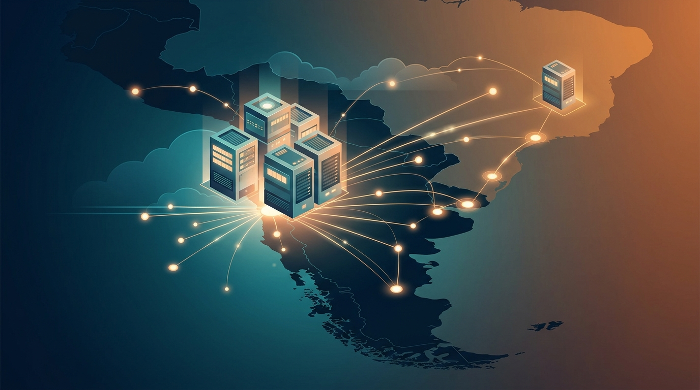

Después de años de pedirlo a gritos, se hizo: **AWS abrió su primera región de infraestructura cloud en Chile**. La región **South America (Chile)** está operativa desde el 11 de noviembre en early access para un grupo de clientes, con disponibilidad general esperada en las próximas semanas. La inversión comprometida: **más de US$4 mil millones**.

## Lo esencial

- **Tercera región de AWS en Latinoamérica** (después de São Paulo y México) y la número 39 de su red global.
- **Mínimo tres zonas de disponibilidad** con energía, refrigeración y seguridad físicamente independientes, como toda región AWS.
- Estimado en **más de US$7.500 millones de aporte al PIB chileno** y un promedio de **4.100 empleos anuales** (telecomunicaciones, construcción, electricidad y operación de data centers).
- Early access ya con nombre conocido: **BancoEstado, BTG, Cencosud, Consorcio, Itaú y Ripley**.

## Por qué importa (y no es solo patriotismo)

Hasta ahora, las empresas chilenas corrían workloads en regiones de otros países. Con la región local, todo cambia de marco:

- **Latencia**: mejor respuesta para usuarios en todo el Cono Sur — Argentina, Paraguay, Uruguay, Bolivia y Perú. Un mercado de 123 millones de personas y US$1,5 billones de PIB que ahora mira a Santiago como punto de presencia.
- **Cumplimiento**: la CMF ya exige requisitos cloud para bancos con cargas críticas, y la nueva ley de protección de datos trae obligaciones de residencia. Tener la región en el país resuelve el punto sin arquitecturas Frankenstein de replicación cruzada.
- **Contexto local**: Chile es primero en el AI Readiness Index de Latinoamérica, con 78% de las empresas integrando IA, un pipeline de inversión en data centers de US$2.500 millones y 338 fintechs activas. La demanda existía; la infraestructura era lo que faltaba.

## Qué servicios llegan

El lanzamiento trae lo básico de siempre: **compute, storage, networking y bases de datos**. Lo interesante viene después: **Amazon Bedrock y SageMaker AI estarán disponibles dentro del primer año**, lo que convierte a la región en plataforma real para cargas de IA con datos que no pueden salir del país.

Los casos ya andan flotando: LATAM usa Bedrock para un asistente que resuelve **32% de las llamadas del call center sin transferencia a humano**, y Copec desplegó un sistema multi-agente en WhatsApp con **8x menos tiempo de respuesta**.

## El dato cool

La región es **primariamente refrigerada por aire** — no requiere uso continuo de agua de refrigeración — y sus data centers serían **7 veces más eficientes que el promedio de la industria** cuando estén a plena operación. Además, AWS entrena gente en Chile desde 2017 (más de 200 mil capacitados) y apunta a **300 mil para 2028** con AWS Entrena Chile.

**Lectura rápida**: si trabajas en una empresa chilina con requisitos de residencia de datos o latencia sensible, el argumento de "no hay región local" acaba de morir. Tiempo de revisar esa arquitectura.
