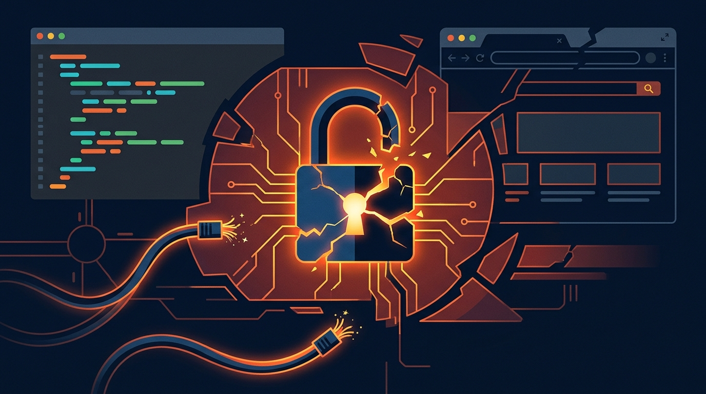

El viernes 13 de noviembre no fue un día tranquilo para los equipos de ingeniería que dependen del ecosistema de Anthropic. A las **09:58 UTC**, la compañía abrió un incidente de severidad mayor en su página de estado tras detectar un pico masivo de errores de autenticación que dejó fuera de juego a miles de usuarios a nivel global.

La falla impactó directamente a **claude.ai**, la interfaz web de la plataforma; a **Claude Code**, el agente de desarrollo en CLI que se ha convertido en pieza clave del flujo de trabajo de miles de desarrolladores; y al portal **platform.claude.com**.

### Lo que pasó y la anatomía de la caída

Durante casi dos horas, los intentos de login en la web y la autenticación de tokens de sesión en la CLI devolvían errores de acceso o tiempos de espera agotados. Sin embargo, hubo un detalle técnico relevante para los equipos de operaciones: **la API directa de Claude (vía API keys fijas en backend) se mantuvo 100% operativa**.

Esto significó que las aplicaciones en producción y pipelines automatizados que consumen la API no sufrieron interrupciones, pero cualquier desarrollador intentando interactuar mediante la CLI de Claude Code o la interfaz conversacional quedó completamente bloqueado.

El equipo de infraestructura de Anthropic logró mitigar la falla y marcar el incidente como resuelto cerca de las **11:58 UTC**, tras aplicar un parche en sus servicios de gestión de identidad y tokens de sesión.

### Por qué importa para el ecosistema de agentes

Este incidente pone sobre la mesa una lección de arquitectura clave en la era del desarrollo asistido por IA:
* **Dependencia de credenciales de usuario en CLI:** Herramientas agénticas como Claude Code requieren autenticación interactiva o tokens OAuth que pasan por la infraestructura de login del proveedor. Cuando el IAM del proveedor tambalea, la productividad del equipo de desarrollo se detiene en seco.
* **Resiliencia de llamadas por API:** Los servicios automatizados desacoplados del SSO conversacional demostraron ser mucho más resistentes ante caídas del plano de control de autenticación.

Con Anthropic a las puertas de su salida a bolsa en Nasdaq (ticker ANT), cualquier parpadeo en la disponibilidad de sus herramientas estrella para developers es analizado con lupa. Por ahora, el servicio está completamente restablecido, pero el recordatorio queda claro: siempre ten a mano un plan B cuando tus agentes de código dependen de la nube.

**Fuentes:** [Anthropic Status Page](https://status.anthropic.com), [AI Weekly](https://aiweekly.co), [Cryptobriefing](https://cryptobriefing.com).
