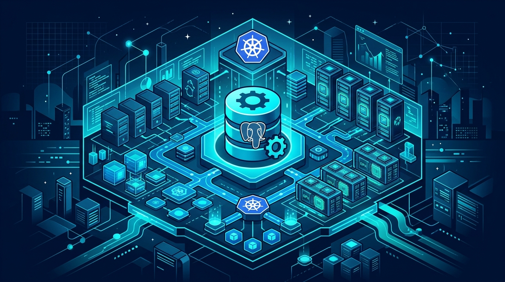

En el marco de las novedades de **KubeCon + CloudNativeCon North America 2026**, CoreWeave dio un paso estratégico importante al anunciar la **disponibilidad general (GA) de CoreWeave Database**, su nuevo servicio administrado de PostgreSQL diseñado específicamente para correr directo dentro de los clústeres **CoreWeave Kubernetes Service (CKS)**.

Hasta ahora, los equipos que entrenaban o servían modelos de IA en la infraestructura de CoreWeave tenían que conectar sus workloads GPU con bases de datos relacionales o vectoriales hospedadas en proveedores externos o gestionar sus propias instancias de PostgreSQL a mano. Con esta movida, el neocloud busca eliminar la latencia de red entre la capa de datos y el cómputo acelerado.

### CloudNativePG en las entrañas: arquitectura Kubernetes nativa

El motor de orquestación detrás de CoreWeave Database aprovecha **CloudNativePG (CNPG)**, el operador open source de PostgreSQL para Kubernetes que casualmente alcanzó el estatus de proyecto *Incubating* en la CNCF esta misma semana.

Al apoyarse en CNPG, CoreWeave delega la complejidad operativa a Kubernetes:
* **Alta disponibilidad y failover automático:** Gestión de pods primarios y réplicas con conmutación por error automatizada en cuestión de segundos.
* **Almacenamiento NVMe de alto rendimiento:** Co-ubicado en la misma red de baja latencia del clúster de cómputo GPU, reduciendo a cero los costos de transferencia de datos *cross-cloud* o entre regiones.
* **Respaldo y restauración integrados:** Políticas de backup continuo con Point-In-Time Recovery (PITR) directo sobre almacenamiento de objetos.

### ¿Por qué importa para las cargas de trabajo de IA agéntica?

Las aplicaciones de IA modernas —especialmente los agentes autónomos, los pipelines de RAG (Retrieval-Augmented Generation) y los sistemas de memoria a largo plazo— dependen críticamente de bases de datos de ultra baja latencia. Cada llamada a un LLM suele ir acompañada de múltiples consultas relacionales o de búsqueda por similitud vectorial (vía extensiones como `pgvector`).

Tener PostgreSQL alojado en un cloud tradicional mientras las GPUs están en un neocloud especializado como CoreWeave introduce penalizaciones de latencia (round-trip time) que degradan la experiencia en tiempo real. Al correr PostgreSQL de forma administrada en la misma malla de CKS, los datos y la inferencia quedan a milisegundos de distancia.

### Conclusión

CoreWeave sigue evolucionando de ser un mero proveedor de renta de GPUs a construir una plataforma cloud completa basada en Kubernetes. La llegada de CoreWeave Database demuestra que Kubernetes es el plano de control indiscutido no solo para contenedores y modelos de IA, sino también para la infraestructura de datos que los alimenta.

**Fuentes:** [CoreWeave Blog](https://coreweave.com/blog), [Cloud Native Now](https://cloudnativenow.com), [CNCF News](https://www.cncf.io/blog).