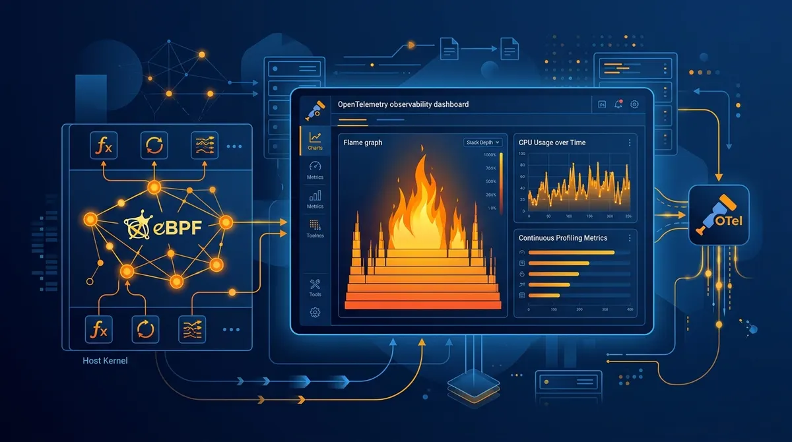

En el marco de **KubeCon + CloudNativeCon North America 2026**, la plataforma de observabilidad **Dash0** anunció la **disponibilidad general (GA) de su motor de Continuous Profiling** (perfilado continuo de código), una de las piezas más esperadas tras la adquisición estratégica de **Polar Signals** realizada hace unos meses.

La integración convierte al perfilado continuo en un pilar nativo de la plataforma de Dash0, permitiendo inspeccionar el consumo de CPU y memoria a nivel de función y línea de código en entornos de producción sin degradar el rendimiento de las aplicaciones.

### eBPF sin agentes pesados: menos del 1% de overhead

El mayor desafío histórico del *continuous profiling* en producción siempre ha sido el consumo de recursos generado por el propio perfilador. Dash0 aborda esto mediante tecnología **eBPF (Extended Berkeley Packet Filter)** heredada de Polar Signals:
* **Overhead ultra bajo:** La recolección de muestras corre directamente a nivel de kernel de Linux, manteniendo un impacto medido por debajo del 1% de CPU incluso bajo cargas extremas.
* **Soporte multilenguaje sin recompilar:** Funciona tanto en lenguajes compilados (Go, Rust, C/C++) como en entornos interpretados o con máquina virtual (Java, Python, Node.js), sin necesidad de modificar el código fuente ni reinstalar binarios.
* **Deduplicación y simbolización bajo demanda:** Gracias al motor de almacenamiento *Great Lakes*, la conversión de direcciones de memoria en nombres de funciones legibles (symbolization) se realiza al momento de consultar, optimizando drásticamente el espacio en disco.

### Correlación directa en OpenTelemetry

A diferencia de las soluciones propietarias que aislan los perfiles en silos independientes, la implementación de Dash0 se alinea directamente con la especificación de **OpenTelemetry Profiling**.

Esto significa que cuando ocurre una anomalía o pico de latencia en producción, los ingenieros pueden saltar instantáneamente desde un *trace* distribuido o una métrica de error directo a la línea de código exacta o llamada de función que estaba consumiendo CPU o bloqueando hilos en ese momento preciso.

### Conclusión

El perfilado continuo se consolida como el "cuarto pilar" indiscutido de la observabilidad moderna junto a los métricas, logs y trazas (MELP). La propuesta de Dash0 al integrar OpenTelemetry, eBPF y Polar Signals marca un estándar claro hacia la observabilidad unificada y de bajo impacto en Kubernetes.

**Fuentes:** [Dash0 Blog](https://www.dash0.com/blog), [Cloud Native Now](https://cloudnativenow.com), [Polar Signals](https://www.polarsignals.com).