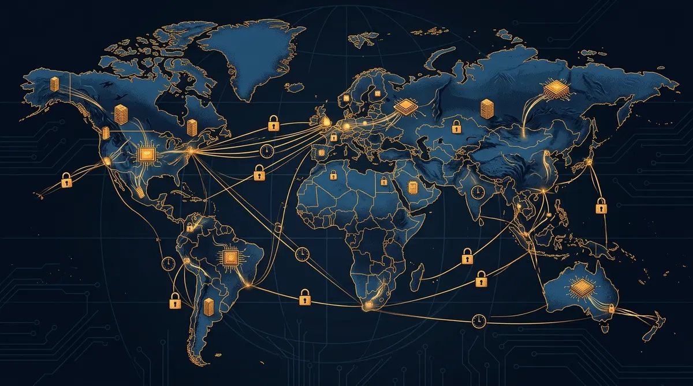

Akamai publicó su reporte global **"Right Workload. Wrong Place."** (con encuesta encargada a Forrester Consulting), y el titular es una bofetada de realidad multicloud: **la mitad de los decisores de TI empresariales mantiene workloads a conciencia en ubicaciones subóptimas** — simplemente para evitar el costo, la complejidad y el downtime de migrarlos. "Trapped by design": atrapados por diseño.

## Los números duros

La encuesta cubrió **528 responsables de infraestructura empresarial** en Norteamérica, EMEA y APAC, en compañías de US$250 millones a más de US$1.000 millones de ingresos:

- **76%** reporta que cargas interactivas/tiempo real ya superan el 25% de su portafolio de software; para el 40%, son más de la mitad
- **51%** ejecuta cómputo productivo en cinco regiones o menos; **37%** admite que su infra está centralizada por restricciones del proveedor, no por decisión arquitectónica
- **82% incumple metas de tiempo de respuesta** en workloads interactivos críticos; el 44% falla en 5% o más de todas las requests
- **80%** sufre tarifas de transferencia de datos impredecibles; el 60% termina negociando dónde guardar los datos versus dónde procesarlos

Las causas raíz son casi físicas: **41%** cita recuperar datos desde una ubicación distinta a la del procesamiento como principal driver de los problemas de latencia, y **38%** apunta a la distancia entre cómputo y usuario final.

## Por qué importa ahora

La tesis de Ari Weil, VP de Cloud Product Marketing de Akamai, es que la infraestructura llegó a un punto de quiebre: con IA conversacional, APIs en tiempo real y microservicios como estándar, **correr cómputo lejos de donde viven los datos ya no es sostenible** — ni financiera ni operativamente. La gravedad de datos y la fricción de migración funcionan como impuesto oculto sobre todo lo interactivo, incluida la inferencia de IA.

El conflicto de interés es evidente y hay que decirlo: Akamai vende exactamente la medicina — una nube distribuida con presencia en decenas de ciudades. Pero el diagnóstico coincide con lo que cualquier equipo de plataforma ve a diario en los egress fees de los hyperscalers y en los ping interregionales.

Para equipos FinOps y de arquitectura, el reporte es material útil para la conversación que nadie quiere tener con su CTO: ¿dónde está *realmente* nuestro cómputo, y cuánto nos cuesta que no esté donde debería?
