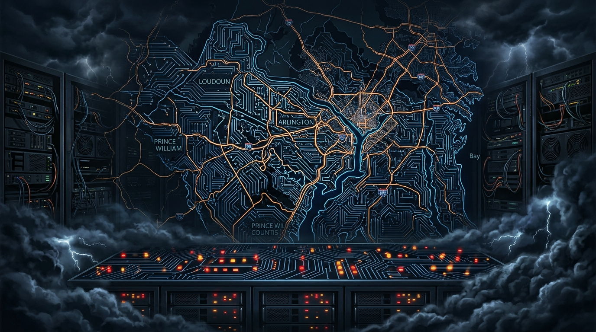

El domingo **15 de noviembre**, la región **US-EAST-1 (Norte de Virginia)** de AWS sufrió una interrupción que dejó **11 servicios afectados**, con fallos de autenticación, errores de sign-up y problemas de conectividad. Tras confirmarse la recuperación total a las 6:53 AM PST, ya tenemos la cronología completa — aunque **la causa raíz técnica sigue sin divulgarse** y AWS descarta actividad maliciosa.

## Cronología del incidente

- **3:05 AM PST**: comienzan los problemas; los ingenieros se activan automáticamente cinco minutos después.
- **4:38 AM**: AWS reconoce públicamente fallos de conectividad regional más errores en **IAM Identity Center** y **AWS Sign Up**. Whoever dependía de Identity Center para el Management Console quedaba fuera — incluidos **Kiro** y **Amazon Connect**.
- **5:20 AM**: el problema de autenticación queda mitigado; la mayoría de los servicios se recupera minutos después.
- **6:53 AM**: resolución final confirmada.

## Los 11 servicios golpeados

IAM Identity Center, IoT Device Management, NAT Gateway, Sign Up, Step Functions, **CloudWatch** (sí, el sistema de monitoreo), Connect, Elastic Load Balancing, OpenSearch, **VPC Lattice** y Kiro. Los usuarios de Kiro con autenticación social no se vieron afectados — ironía de las dependencias de identidad.

## Lo interesante desde ingeniería

El incidente llegó **en dos etapas**: primero la caída masiva de autenticación, y luego un problema residual de conectividad que persistió en un subconjunto de **Network Load Balancers dentro de una sola celda** de la zona de disponibilidad use1-az1. Ahí se vio la arquitectura basada en celdas haciendo su trabajo: el daño residual quedó contenido en una celda en vez de propagarse regionalmente.

La lección de siempre, ahora con twist agéntico: tu observabilidad y tu pipeline de deploy también dependen de la nube que se cae. Tener dashboards y alertas fuera de la región afectada (multi-región o on-prem) volvió a demostrar su valor el domingo. Y con KubeCon recién cerrado predicendo resiliencia, N. Virginia sigue siendo el recordatorio anual de que la concentración de servicios críticos en una región no es un riesgo teórico.

**Fuente**: AWS Status History, reportes de GBHackers y CyberPress.
