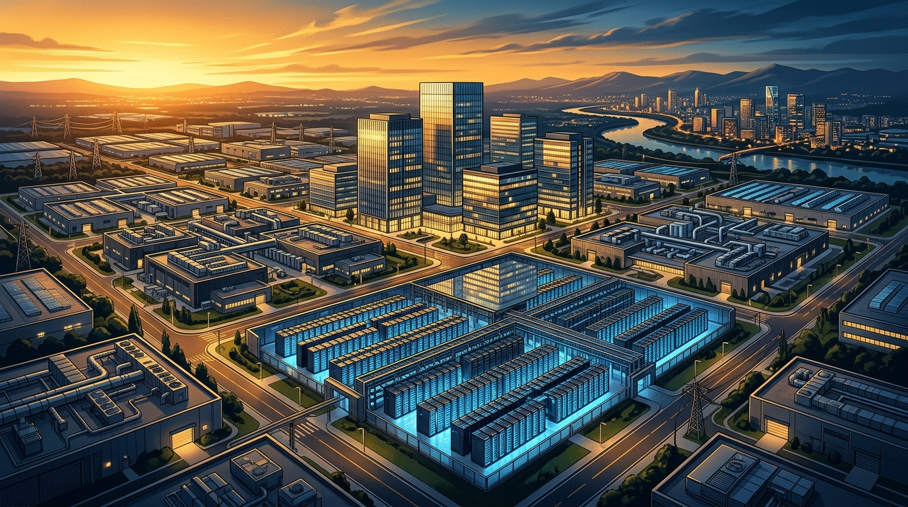

**Blackstone** siguió comprando ladrillo digital: su vehículo de adquisición de data centers recién listado en bolsa tomó la **mayoría en dos joint ventures con afiliados de Amazon**, valorizando los activos en torno a los **US$5 mil millones**. Un afiliado de Amazon se queda con un ~25% sin control, y **AWS arrienda de vuelta los 13 "powered shells"** bajo contratos de largo plazo. Bloomberg y Quartz reportaron el acuerdo este lunes.

## La jugada: vender ladrillo para comprar GPUs

La lógica financiera es straightforward: Amazon libera capital atado a edificios y lo redirige a **capex de infraestructura de IA** —chips, networking y capacidad de cómputo— mientras Blackstone captura rentas de largo plazo de un tenant de máxima calidad crediticia. Los "powered shells" son edificios con energía y refrigeración listos para que AWS los llene de sus propios racks.

## Parte de una tendencia mayor

- Los hyperscalers están metidos en una carrera de capex sin precedentes —hablamos de cientos de miles de millones al año en conjunto— y cada dólar cuenta.
- Vender participaciones de data centers a fondos (modelo *sale-leaseback* y JV) se está volviendo herramienta estándar: convierte activos inmobiliarios en munición para GPU.
- Para los inversionistas, data centers con contratos AAA se han convertido en la clase de activo de moda, con vehículos dedicados listándose para capturar el flujo.

Para el ecosistema cloud native el mensaje es indirecto pero relevante: **la propiedad física se está financializando**. La capacidad de cómputo detrás de tu cluster de Kubernetes cada vez más se financia con estructuras inmobiliarias, y la competencia por energía y edificios es tan feroz como la por chips.

**Fuentes**: Bloomberg, Quartz.
