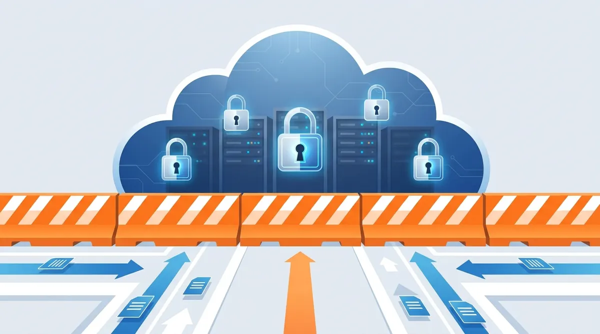

Cloudflare pasó **Application Services for Private Origins** a disponibilidad general, y la idea de fondo es de esas que cambian reglas tácitas que llevábamos años asumiendo: ahora el tráfico de internet puede llegar a aplicaciones hosteadas en redes privadas **sin exponer direcciones IP ni abrir puertos inbound en el firewall**. Anunciada en beta cerrada en junio, la función llega con configuración simplificada: las IPs privadas se detectan automáticamente en registros DNS proxied, y el routing privado se configura vía API de DNS.

## El caso de uso es muy 2026

El equipo de producto lo dice sin anestesia: los clientes tenían **APIs internas, backends de agentes de IA, servidores MCP y herramientas operativas** que nunca fueron diseñados para mirar internet… pero que igual necesitan recibir requests de partners, clientes o agentes desde internet. Hasta ahora, eso significaba agujerear security groups o levantar infraestructura extra.

Con Private Origins, todo el stack de Cloudflare se aplica igual que a una app pública: **WAF, bot management, rate limiting, caching, aceleración, rewrites y Workers** delante de cosas que viven en red privada. También soporta orígenes privados TCP/UDP vía Spectrum y conectividad privada para Workers.

## Requisitos y la implicancia DNS

Para usarlo: entitlement de Private Origins, conectividad Cloudflare One y Unified Routing (exento si usas Cloudflare Tunnel). Las conexiones WAN/Mesh necesitan rutas de retorno para los rangos fuente de Cloudflare (IPv4 100.64.0.0/12 y el IPv6 correspondiente).

El consultor Simon Painter puso el dedo en la llaga: durante años la regla fue **"si responde a un nombre DNS público, es alcanzable desde internet"**. Con esto, esa regla deja de ser cierta — la superficie de ataque se redibuja al revés: lo privado puede recibir tráfico público controlado. No es un wrapper de marketing; es un cambio de modelo.

## Contexto y lo que viene

No es territorio virgen: AWS tiene CloudFront VPC Origins y Microsoft ofrece algo equivalente con Azure Front Door Premium + Private Link. La diferencia está en lo operativo — sin software connector extra y con la política de seguridad ya aplicada. Lo que no quedó claro es el precio: Cloudflare no precisó si cobra aparte o viene incluido en contratos Enterprise.

Próximo capítulo: **private-to-private** — usuarios, servicios y agentes de IA en una red privada accediendo apps en otra. Beta cerrada apuntada para comienzos de 2027. Con los agentes IA multiplicándose, ese flujo máquina-a-máquina privado va a ser el plato principal.
