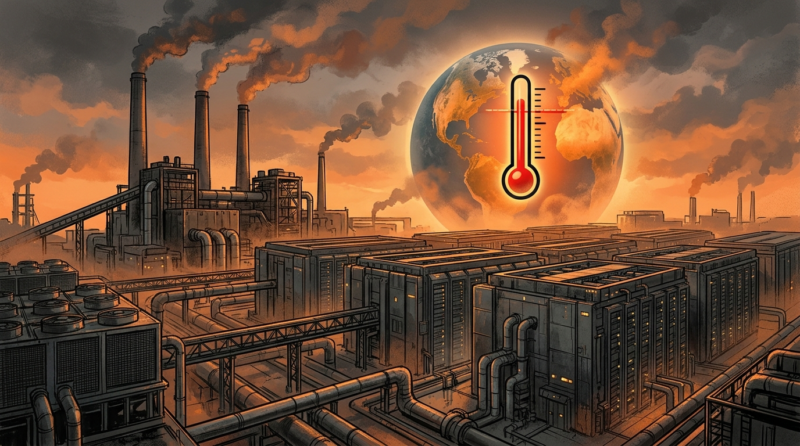

La factura ambiental del boom de la IA sigue subiendo: una investigación publicada en **Nature Sustainability** estimó que los **403 datacenters "hyperscaler" de Estados Unidos emitieron unos 25,7 millones de toneladas métricas de CO₂** en el año hasta abril de 2025 — aproximadamente **lo mismo que emite Dinamarca completa**, un país de 6 millones de personas, en un año. La cifra es **dos a tres veces mayor** que la estimación previa de emisiones hyperscale de 2018.

## Los números del estudio

- Los hyperscalers —los data centers más grandes, dedicados principalmente a IA— consumieron entre **68 y 99 terawatt-hora** de electricidad en el período
- Representan cerca del **1,8% del consumo eléctrico total de EE.UU.**
- **Más de la mitad** de la generación que usan proviene de **combustibles fósiles**
- La demanda se concentra en Virginia, Oregon, Ohio e Iowa

Y ojo con el asterisco: los investigadores advierten que es **casi seguro una estimación conservadora**. Los datos llegan solo hasta abril de 2025 y desde entonces la construcción de data centers **solo se aceleró**. "Hay que pensar en este nivel de emisiones como un piso", resumió Francesca Dominici, profesora de bioestadística de Harvard y coautora del estudio, liderado por Gianluca Guidi.

## Gas en vez de renovables

Un dato incómodo para las narrativas verdes del sector: el crecimiento de la IA está siendo alimentado por **nuevas plantas a gas** —a veces construidas al lado mismo de los data centers— en desmedro de renovables ya instaladas como solar y eólica. "No me sorprende que la mayoría de los hyperscalers dependan de combustibles fósiles a pesar de los profundos impactos climáticos y en salud que podrían evitarse", afirmó Gina McCarthy, ex asesora climática del gobierno de Biden.

## El trasfondo político

El estudio cae en medio de una **reacción pública bipartidaria** contra los data centers que no amaina: protestas y demandas por ruido y contaminación en Memphis (el cluster de xAI de Musk, que respondió comprando las casas de los vecinos afectados), movilización por el uso de agua del megaproyecto Stratos en Utah golpeada por sequía... mientras Trump asegura que quienes se opongan al crecimiento de los data centers terminarán "backwards and poor".

Con cada hyperscaler nuevo aprobándose a ritmo récord, la pregunta de cómo alimentar la IA del futuro sin cocinar el planeta en el intento pasa de inquietud ambiental a problema de política pública de primer orden. Este estudio le puso número —y una bandera roja— al asunto.

Vía [The Guardian](https://www.theguardian.com/us-news/2026/nov/16/datacenter-emissions-study).
