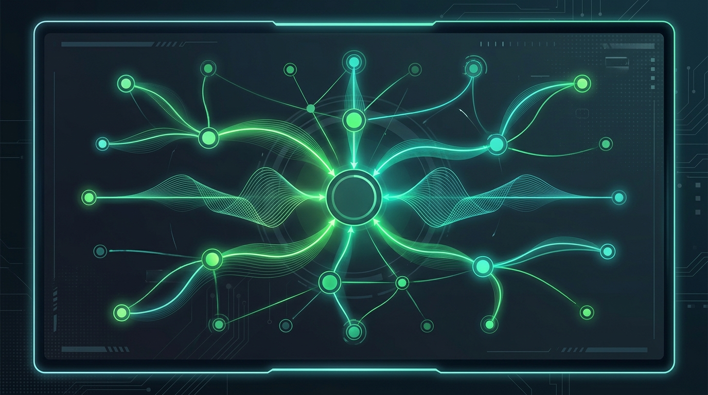

Dynatrace fue nombrado **Leader en el último Forrester Wave de plataformas AIOps**, la evaluación que comparó **10 proveedores en 24 criterios**. El dato fino: recibió el **puntaje más alto de la categoría Current Offering**, con la máxima nota en **16 criterios**, incluyendo los tres que hoy definen la categoría: análisis causal de root cause, **SRE autónomo con orquestación de IA**, y confianza/explicabilidad algorítmica.

## Lo que dice Forrester

Los analistas fueron directos: la "amplitud, rendimiento, escala y madurez operacional posicionan a Dynatrace para la consolidación empresarial, además del uso en casos acotados". Los clientes citados destacaron la "simplicidad operacional, recomendaciones confiables y la capacidad de centralizar la toma de decisiones operacionales".

El reporte elogia además la coherencia del stack: **Grail, Smartscape, Dynatrace Intelligence y las operaciones agénticas en una sola historia arquitectónica**. Sobre Dynatrace Intelligence, Forrester destaca que "combina IA determinista con IA agéntica para operaciones autónomas supervisadas", con Grail y Smartscape dando contexto unificado sobre métricas, logs, trazas, eventos, seguridad y dependencias de aplicaciones.

## El contexto: la batalla es por la confianza

El fondo de esta evaluación es la pregunta que ronda toda compra de AIOps en 2026: ¿la IA puede explicar **por qué** recomienda lo que recomienda? Los compradores ya no se conforman con automatismo — exigen respuestas verificables antes de dejar que un sistema actúe sobre producción. Steve Tack, CPO de Dynatrace, lo resumió: "los clientes quieren poner IA a trabajar, pero necesitan respuestas en las que puedan confiar antes de actuar".

El momento no podría ser mejor para la empresa: la semana pasada presentó su informe State of Observability y en su última llamada de resultados los ejecutivos reportaron que **los clientes de IA consumen la plataforma al doble de velocidad** que los tradicionales — la complejidad de observar workloads de IA está empujando la adopción de AIOps causal, justo el terreno donde Dynatrace apuesta fuerte.

Como siempre con los Wave: son una entrada más al proceso de compra, no un veredicto. Pero en un mercado donde todos los vendors gritan "IA" en cada slide, que Forrester marque la diferencia en explicabilidad y causalidad dice bastante de hacia dónde se está moviendo el estándar de la categoría.
