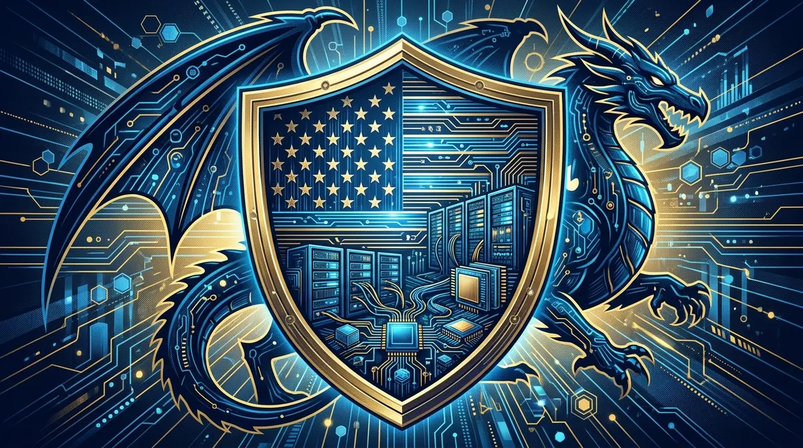

Nueva jugada geopolítica en la guerra de la IA: según reporta **The Wall Street Journal**, la administración Trump planea designar a **más de dos docenas de empresas como "campeones nacionales" de la IA** — con **Nvidia, Amazon, Microsoft, OpenAI y Anthropic** entre las destacadas. El objetivo es directo: ayudar a las firmas estadounidenses a **ganarle negocios en el exterior a los rivales chinos**.

## Qué significa esto en la práctica

El programa apunta a **paquetizar la oferta** para compradores extranjeros: chips, modelos y otros productos de IA estadounidenses se bundlearían en combos más fáciles de comprar para gobiernos y empresas de otros países. El anuncio —que según fuentes familiarizadas podría caer **dentro de la próxima semana**— sería unveileado por el Secretario de Comercio **Howard Lutnick**, aunque el timing aún puede cambiar.

No es un plan surgido de la nada: Commerce ya opera el **American AI Exports Program**, creado por executive order en julio de 2025 para vender paquetes completos de IA gringa al exterior. En julio pasado el departamento informó que consorcios de empresas habían presentado **78 aplicaciones**. Los paquetes designados podrían recibir abogación gubernamental, financiamiento federal y revisiones de licencia de exportación más rápidas.

## El contexto: China también juega

Del otro lado del tablero, Beijing empuja su propia IA hacia afuera: en octubre, medios estatales chinos reportaron que el gobierno autorizó a **DeepSeek y MiniMax** a llevar sus modelos al exterior.

Y hay un detalle fino que hace el asunto aún más picante: la lista llegaría **la misma semana en que Trump viaja a China** para la cumbre de APEC en Shenzhen (18 y 19 de noviembre), donde tiene previsto reunirse con Xi Jinping.

## Nvidia en el ojo del huracán

La designación de Nvidia como "campeón nacional" llega en plena crisis interna de la empresa: Jensen Huang renunció como CEO el jueves tras admitir un affair con una persona que funcionarios estadounidenses sospechan de espionaje para China. El plan muestra que la administración sigue adelante con su estrategia tech **a pesar del terremoto en Nvidia**, pero los críticos —que piden priorizar seguridad nacional por sobre market share— señalan que compañías chinas siguen obteniendo chips top de Nvidia a través de huecos en los controles de exportación. El propio Lutnick ha sido acusado de no cerrar esas brechas.

En resumen: industrial policy en estado puro. El estado gringo eligiendo ganadores y armando combos de exportación para competir contra el estado chino haciendo lo mismo. El mercado global de IA se está jugando cada vez menos en el mercado y cada vez más en Washington y Beijing.

Vía [The Next Web](https://thenextweb.com/news/ai-national-champions-nvidia-openai-anthropic-trump) y [WSJ](https://www.wsj.com/tech/ai/trump-administration-to-name-nvidia-among-ai-national-champions-c9284344).
