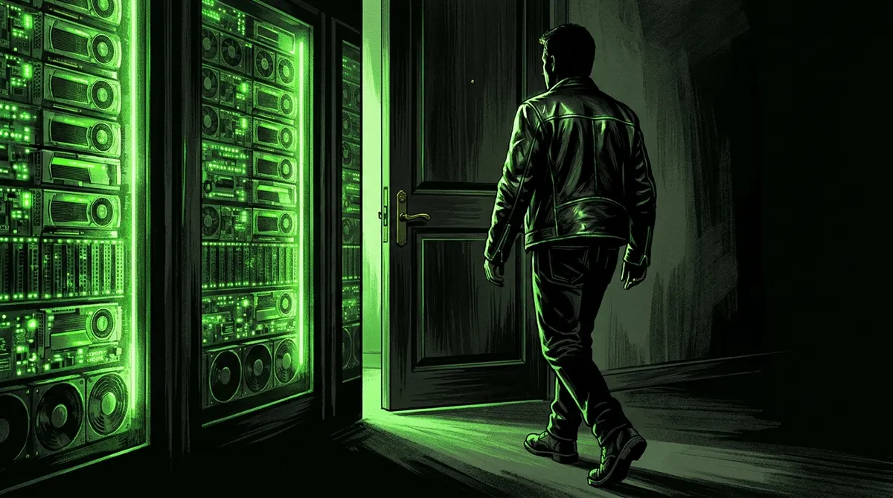

La telenovela Nvidia tiene capítulo nuevo, y no va hacia donde muchos esperaban. Aunque en Silicon Valley crece el coro que pide el regreso de **Jensen Huang**, una fuente familiar con el asunto le dijo a CNBC que **el directorio de Nvidia no está considerando traerlo de vuelta como CEO**. La mesa está enfocada en la investigación liderada por el estudio jurídico **Wachtell Lipton**, que indaga si la conducta de Huang comprometió seguridad nacional o secretos corporativos. No hay conversaciones de regreso.

## Contexto rápido del terremoto

Huang renunció la semana pasada, después de **33 años liderando la empresa que fundó**, tras admitir un affair y luego de reportes de prensa que alegaban romances adicionales —incluido uno con una persona que trabajaba para un cliente y que, según esos reportes, habría tenido contacto con inteligencia china. Nada de eso está probado en tribunales, pero el escándalo fue suficiente para que legisladores estadounidenses pidieran su salida y para que la acción cayera más de un 4% el día del anuncio. Hoy volvió a caer.

## El club del regreso (que no convence a la mesa)

El fin de semana, el *Financial Times* reportó que Huang habría conversado con aliados sobre una vuelta. **Brad Gerstner de Altimeter Capital** dijo hoy que Huang no le planteó nada. Mientras tanto, una petición online pidiendo su reincorporación ya junta **180.000 firmas**, con respaldos de peso: Elon Musk, Garry Tan (Y Combinator) y Tim Sweeney (Epic Games). Hasta **Donald Trump** dijo estar abierto a que vuelva. Pero la fila del directorio va por otro lado: el viernes ya estaban seleccionando la firma de búsqueda para el nuevo CEO.

## Por qué esto importa más allá del chisme

- **Resultados Q3 mañana martes**: la interina **Colette Kress** (ex CFO) presenta el trimestre con la acción bajo presión y sin su cara más reconocible frente a los inversionistas.
- **Stake gigante**: Huang se va dejando unos US$108 millones en equity sin consolidar, pero conserva un paquete cercano a los **US$132 mil millones** en acciones, con reglas de venta que se relajan justo ahora.
- **Infra IA en juego**: con Anthropic presumiendo que Claude Mythos escribe casi el 100% de los kernels para onboarding de GPUs AMD y erosiona el foso de CUDA, la última cosa que Nvidia necesitaba era incertidumbre en su liderazgo.

Para quienes construimos sobre este ecosistema —Kubernetes, inferencia, GPU clouds— el mensaje es claro: el roadmap institucional sigue, pero la era del fundador-carisma como ventaja competitiva en Nvidia quedó, al menos por ahora, en pausa.

**Fuentes**: CNBC, Financial Times, Yahoo Finance.
