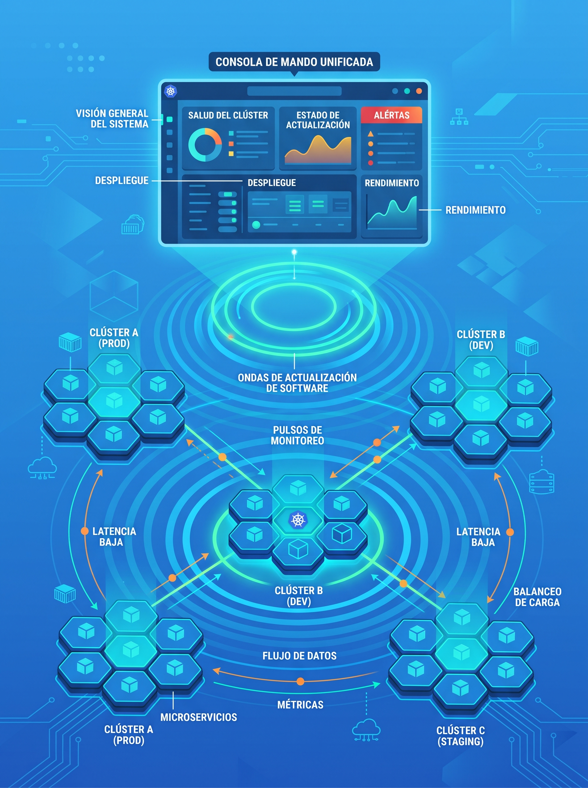

En el marco de **Microsoft Ignite 2026**, Azure anunció nuevas experiencias para **Kubernetes Center**, su superficie unificada para entender tu *estate* de Kubernetes y actuar sobre él. Si manejar clusters era andar saltando entre vistas, revisando prerequisitos de upgrade uno por uno y conectando señales de monitoreo a mano, la idea es que todo eso pase a vivir en un mismo lugar.

## Lo nuevo que llega a Kubernetes Center

- **Multicluster update e insights**: identifica qué clusters necesitan atención *antes* de un upgrade de versión de Kubernetes, revisa issues bloqueantes y, cuando estés listo, los workflows integrados con **Fleet Manager** permiten crear y rastrear corridas de actualización coordinadas entre clusters.
- **Monitoring insights**: visibilidad más profunda de nodos y pods, con foco en nodos *not-ready* y pods fallidos o pendientes. Puedes explorar recursos afectados por cluster y estado, y navegar directo al recurso para investigar. Además marca clusters sin cobertura de **Container Logs** o **Managed Prometheus**, con ruta directa para configurarla.
- **Resource placement con Fleet Manager**: la experiencia de distribución de recursos de Fleet dentro de Kubernetes Center, para manejar placement policies entre clusters miembros, ver membresía de fleets y armar flujos de despliegue multicluster sin salir del contexto de gestión.
- **AI Manager para AKS (preview)**: el que más llama la atención. Selección de modelos desde un catálogo, despliegue a cluster nuevo o existente con el SKU y perfil que quieras, y post-despliegue: estado del endpoint, pruebas de respuestas, **costo por deployment y namespace**, y métricas de inferencia y GPU.

## El contexto

Las capacidades de **seguridad** de Kubernetes Center ya están disponibles; lo anunciado ahora (multicluster update, resource placement, monitoring insights y el preview de AI Manager) está planificado para Ignite. La jugada es clara: Microsoft quiere que administrar una flota de clusters con cargas de IA se parezca más a operar una plataforma y menos a hacer malabares con cinco pestañas del portal.

Para los equipos que ya viven en AKS, el monitoreo con lupa de cobertura (qué cluster no está mandando logs o métricas) y el AI Manager con vista de costos por namespace son las dos piezas más jugosas. Desplegar un modelo de un catálogo y ver al tiro cuánto cuesta su inferencia por namespace es el tipo de cosa que hoy exige pegar dashboards a mano.
