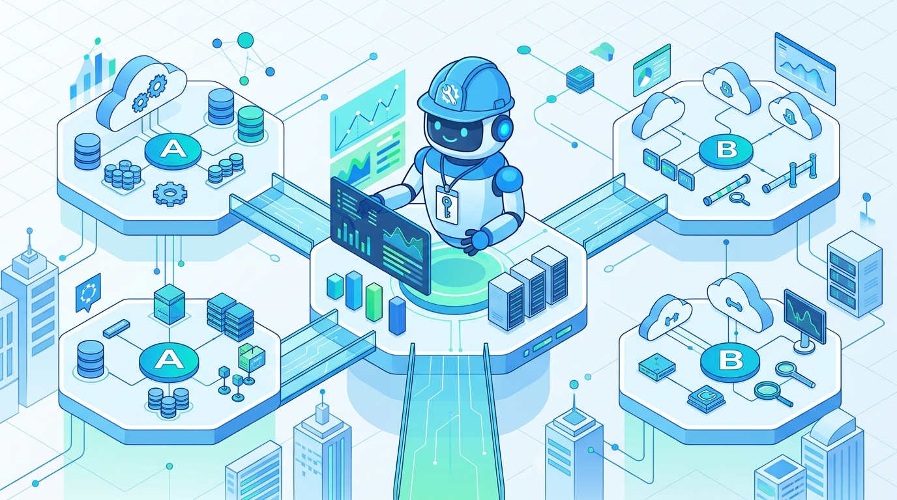

Uno de los giros más pragmáticos del Microsoft Ignite 2026: **Azure SRE Agent — el agente que investiga incidentes, encuentra causas raíz y automatiza tareas operativas — ahora habla con AWS y Google Cloud** mediante conectores nativos en public preview.

## Cómo funciona la identidad

El diseño es el interesante. El agente **federa su identidad desde Azure managed identity, pero el acceso efectivo lo controla el IAM de la nube de destino**. Traducción: no es que el agente tenga llaves maestras universales; es que presenta credenciales de Azure y cada cloud decide, con sus propias políticas, hasta dónde llega. Para los equipos de seguridad, eso significa un solo plano de identidad federada en vez de secrets repartidos por tres consolas.

## Lo demás que llegó al SRE Agent

La oleada de preview incluye varias mejoras que apuntan a producción seria:

- **Customer-managed encryption keys** para controlar el cifrado con tus propias llaves.
- **Integración con Entra Agent ID**, la identidad específica para agentes.
- **Comunicación entre agentes (A2A)** en preview, aunque Microsoft todavía no publica detalles de versiones, transporte, regiones ni autenticación.
- Integraciones con **Teams** para el flujo de investigación de incidentes y con **Agent 365**.

Todo enmarcado en la apuesta de "agentic operations": los features de Azure ya no solo se consultan vía MCP, **también se controlan** — un agente puede, por ejemplo, crear recursos.

## La lectura

Un SRE agent que solo veía Azure tenía techo bajo: la mayoría de las empresas opera multi-cloud sí o sí. Federar identidad y respetar el IAM local de cada nube es la única forma en que un agente autónomo sobrevive a una revisión de seguridad. Que Microsoft apunte a operar las nubes rivales desde su propio agente es una jugada ambiciosa — y una señal de que la pelea de AIOps se va a librar sobre las tres nubes a la vez.

**Fuentes:** [Windows Forum](https://windowsforum.com/news/azure-sre-agent-adds-aws-and-google-cloud-connectors-in-public-preview.452841/), [Microsoft Tech Community — Agentic Operations en Ignite 2026](https://techcommunity.microsoft.com/blog/azureinfrastructureblog/advancing-agentic-operations-on-azure-at-ignite-2026/), [Redmond Mag](https://redmondmag.com/articles/2026/11/17/major-azure-updates-for-enterprise-it-land-at-microsoft-ignite.aspx).
