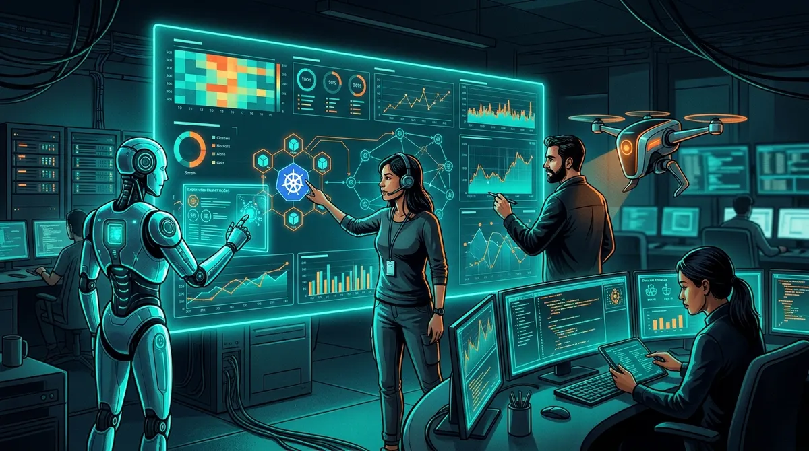

groundcover, la israelí de observabilidad que el año pasado levantó US$100 millones para incomodar a Datadog, va de nuevo con un lanzamiento que pinta el tono de la industria: **Agent Investigations**, un workspace compartido donde sus propios agentes de IA, los coding agents de tu equipo y los ingenieros on-call trabajan el mismo incidente de producción.

## El problema que ataca

Cuando algo se cae hoy, cada ingeniero apunta su agente favorito al problema y cada uno investiga por su cuenta. Las conclusiones quedan tiradas en chats privados, tickets o hilos de Slack que el resto del equipo nunca ve. Según groundcover, esa dispersión es la nueva normalidad de la respuesta a incidentes con IA — y es un desperdicio.

## Cómo funciona

- **Investigaciones automáticas**: al abrirse una alerta de monitor, groundcover inicia la investigación solo. También se puede lanzar a mano desde la interfaz o con un botón en Slack.
- **Agente Investigator**: construye un grafo de preguntas e hipótesis y las testea una a una contra logs, métricas, traces y datos de Kubernetes, adjuntando la evidencia a cada hallazgo.
- **Agente Moderator**: el único autorizado a cerrar una hipótesis. Toda conclusión sin evidencia que la respalde se devuelve. Generar una explicación y validarla quedan separados, a propósito.
- **El resultado**: hipótesis testeadas con veredicto (soportada o refutada) en vez de páginas de texto generado. Y el grafo queda como registro del post-mortem, mostrando también los caminos que se descartaron.

## La parte interesante: los agentes de afuera

Por el **servidor MCP de groundcover** pueden entrar agentes externos como **Claude Code y Codex**, que leen y aportan a la misma investigación (también hay espacio para agentes de BI o de roadmap de producto). Los estados y veredictos se publican en el hilo de Slack asociado a la alerta, y las respuestas de ese hilo se reintegran a la investigación: puedes dirigir el trabajo desde la conversación del incidente, sin cambiar de herramienta.

"Every engineer now has an agent, but each of those agents investigates on its own and findings end up in a chat window", resume el CEO y cofundador **Shahar Azulay**. La apuesta: humanos y agentes compartiendo un solo lugar, donde toda conclusión tiene que estar respaldada por datos de producción. Todo sobre la telemetría full-fidelity de su sensor y con arquitectura bring-your-own-cloud: los datos no salen de la cuenta cloud del cliente.

Agent Investigations ya está disponible para clientes con backend AI habilitado, y se podrá ver en vivo en **AWS re:Invent** (Las Vegas, 30 de noviembre al 4 de diciembre). Después del anuncio de Grafana en ObservabilityCON convirtiendo las sesiones de agentes en quinta señal de telemetría, el mensaje de la semana es claro: **la observabilidad del near future es observar agentes con agentes**.

**Fuentes:** [SiliconANGLE](https://siliconangle.com/2026/11/19/groundcover-launches-agent-investigations-a-shared-workspace-for-ai-agents-and-engineers/) · [DevOps.com](https://devops.com/groundcover-adds-observability-workspace-to-foster-collaboration-with-ai-agents) · [The New Stack](https://thenewstack.io/groundcover-ai-incident-investigations/)
