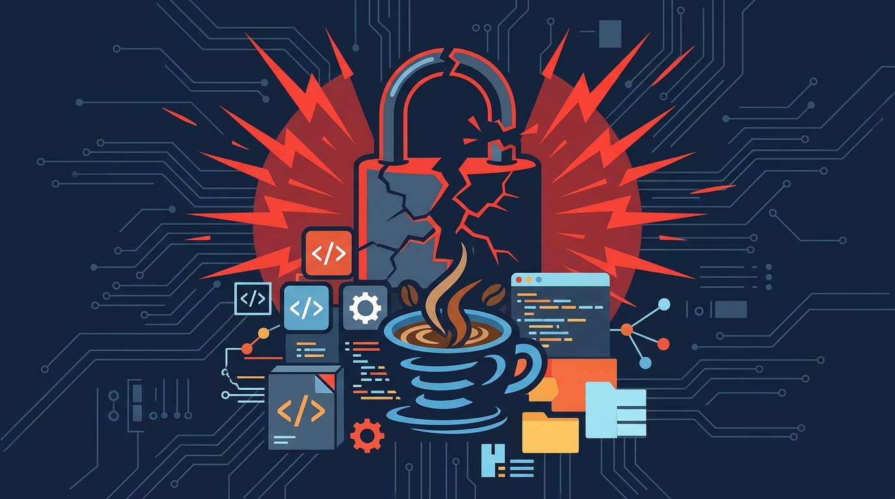

Si tienes Java corriendo en producción, deja de leer esto en 30 segundos y ve a revisar tu versión de la JVM. **Java4Shell (CVE-2026-114938)** es una vulnerabilidad de corrupción de memoria en el decodificador Base64 del HotSpot JVM que permite **ejecución remota de código sin autenticación**, y tanto **CISA** como el Centro de Ciberseguridad de Canadá publicaron alertas pidiendo parchear de inmediato.

## ¿Qué pasó exactamente?

- La firma de seguridad **Calif** (crédito para Quang Luong y Albert Yang) descubrió el flaw y lo reportó, pero **los detalles se filtraron antes del parche**, obligando a publicar antes de lo previsto.
- **Oracle** largó los builds corregidos el **17 de noviembre** dentro de su Critical Security Patch Update, y el OpenJDK Vulnerability Group publicó su propio advisory el mismo día.
- Oracle lo puntúa **8.1 en CVSS 3.1**; Calif dice que en **CVSS 4.0 se va a 9.2**. Spoiler: en la práctica, ninguno de los dos números es tranquilizador.

## ¿Quién está expuesto?

Aquí está lo traicionero: el bug vive en el **decoder Base64 con instrucciones AVX-512** de la JVM, así que solo se cumple la trifecta si:

- Corres **Java 17.0.6+, 21, 25 o 27** en HotSpot (Temurin, Corretto, Azul Zulu, etc.).
- Tu servidor es **x86-64 con AVX-512 VBMI**: Intel Xeon Ice Lake o superior, AMD Zen 4 o superior. **ARM queda fuera**, y Java 8 y 11 tampoco están afectados.
- Tu app **pasa input controlado por el atacante al decoder** de java.util.Base64: headers de autenticación, tokens, uploads. O sea, el pan de cada día de cualquier servicio web.

Calif demostró **RCE sin login en configuraciones por defecto de productos como Atlassian Jira, Jenkins y Keycloak**. Las versiones EOL (18-20, 22-24, 26) tienen el mismo código pero **no recibirán fix**, así que si aún corres algo de eso, el plan de migración acaba de volver urgente.

## El estado del parcheo (al 18-N)

- **Oracle**: builds fijados 17.0.21.1, 21.0.13.1, 25.0.5.1 y 27.0.1.1.
- **Amazon Corretto, Azul y GraalVM**: ya tienen builds corregidos. Ojo: las imágenes de Corretto en Docker Hub **mantienen los mismos tags**, así que hay que hacer **pull de nuevo** y recrear los contenedores.
- **Eclipse Temurin**: fixes para Java 21, 25 y 27; Java 17 iba demorando al cierre de esta nota, igual que Red Hat y Microsoft.
- **Mitigación temporal** mientras actualizas: arrancar la JVM con el flag -XX:-UseBASE64Intrinsics, que desactiva el código SIMD vulnerable.
- Y el clásico que siempre se olvida: **después de actualizar, reinicia todos los procesos Java**. Reemplazar los binarios no toca una JVM que ya está corriendo.

## ¿Ya hay explotación?

Todavía no hay confirmación de compromisos exitosos, pero el escenario se está calentando rápido: **GreyNoise ya detectó intentos de explotación**, **VulnCheck reporta un exploit funcional disponible** para sus clientes, y el investigador Kevin Breen (Immersive) construyó uno propio. El CVE aún no entra al catálogo KEV de CISA, pero con esta velocidad, no apostaría a que tarde.

Mientras tanto, **Cloudflare ya publicó reglas WAF** para ayudar a bloquear intentos de explotación de Java4Shell, una capa extra si no puedes parchear todo de golpe.

## La lectura

El nombre Java4Shell no es casual: recuerda a Log4Shell, y aunque el alcance acá es más acotado (requiere CPU específica y versiones recientes), el patrón se repite: **infraestructura ubicua, input básico, RCE pre-auth**. Con la mayoría del ecosistema enterprise corriendo sobre JVMs modernas en Xeon y EPYC nuevos, este finde va a ser largo para más de un equipo de SRE.

**Fuentes:** [Tenable FAQ](https://www.tenable.com/blog/java4shell-cve-2026-114938-frequently-asked-questions-about-openjdk-rce-vulnerability) · [Cycode](https://cycode.com/blog/java4shell-cve-2026-114938/) · [Cloudflare WAF](https://blog.cloudflare.com/java4shell-waf-protection/) · [CISA](https://www.cisa.gov/news-events/alerts/2026/11/17/critical-java-vulnerability-requires-immediate-patching)
