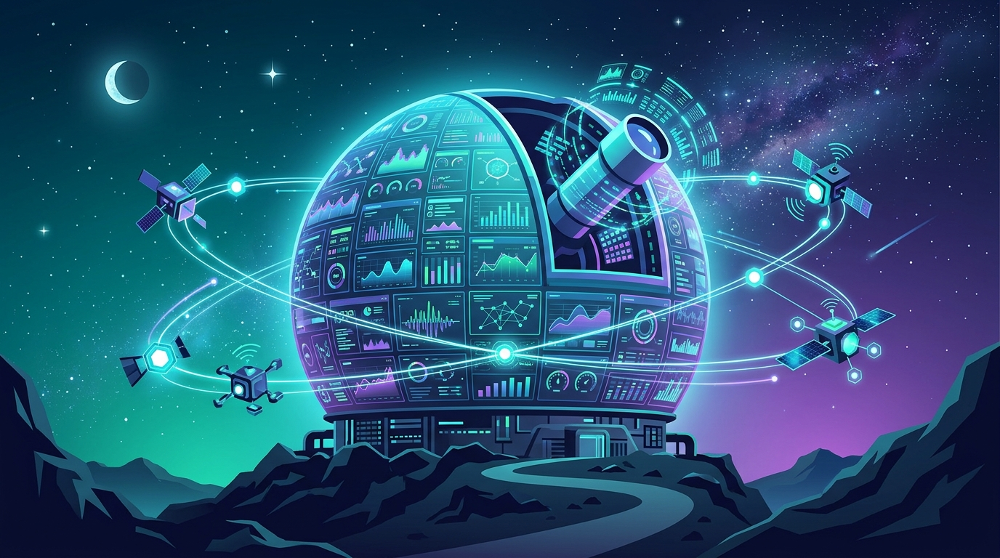

Mientras el mundo tech miraba la bolsa de Nueva York, en San Francisco se celebró **ObservabilityCON 2026** y Grafana Labs aprovechó de vaciar el carro de anuncios. El eje: **operaciones autónomas con IA, economía del cloud y visibilidad de punta a punta**, incluyendo una pieza que faltaba en el rompecabezas: observar a los propios agentes de IA como una señal más de telemetría.

## IA que monitorea tu IA

- **Agent Observability** incorpora las **sesiones de agentes como quinta señal de telemetría**, correlacionada con métricas, logs, traces y perfiles. Cuando tu "usuario" es un enjambre de agentes tomando decisiones solo, esto deja de ser lujo y pasa a ser requisito.
- **Assistant Watchers llegó a GA**: agentes siempre encendidos que describís en lenguaje natural, aprenden una línea base de tu telemetría histórica y avisan cuando el patrón cambia, cubriendo lo que las reglas de alerta predefinidas no ven.
- **Grafana Managed Sandboxes (preview)**: un entorno controlado en el cloud donde el Assistant revisa código fuente, consulta telemetría en vivo y **prepara pull requests con fixes propuestos** que un humano revisa y aprueba. DevOps con copiloto integrado, literal.
- **Grafana Pages (preview)**: visualizaciones que se comportan más como apps que como dashboards, construidas describiendo lo que necesitas, sin escribir código.

## La guerra por el peso de la telemetría

Con los volúmenes de datos disparados por el trabajo con IA, el otro gran anuncio fue la suite **Adaptive Telemetry**, con clientes reportando **rebajas de 30% a 50% en gasto de telemetría**:

- **Adaptive Metrics auto-apply en GA**: aplica recomendaciones continuamente sin romper dashboards ni alertas, y el modo cost-first incluye un seguro para que la optimización nunca se convierta en un spike de costo.
- **Adaptive Logs Archive (preview)**: manda logs a un bucket de object storage propio, barato y disponible para auditorías, con replay bajo demanda para traerlos de vuelta cuando hagan falta.
- **Full-text search GA en Grafana Cloud Logs**, construido sobre la tecnología de Logline (la adquisición de abril): índice secundario sobre Loki para encontrar una línea específica entre semanas de logs en segundos. El caso de DATEV es contundente: de procesar casi 1 TB en tres minutos a **100 GB en menos de 3 segundos**, una reducción de 80-90% en el volumen escaneado.

## La lectura

Grafana está jugando sus cartas en la dirección correcta: si 2026 es el año de los agentes en producción, el que observe mejor (y más barato) se queda con la mesa. El movimiento de **tratar a los agentes como primera clase en la telemetría** marca el estándar que el resto de la industria (Datadog, Dynatrace, Honeycomb) tendrá que seguir. Y el mensaje de costos llega justo cuando las cuentas de cloud con carga IA empiezan a doler.

**Fuentes:** [Grafana Labs](https://grafana.com/blog/observabilitycon-2026-announcements/) · [Full-text search](https://grafana.com/blog/find-the-log-line-that-matters-faster-with-full-text-search-in-grafana-cloud-logs/)
