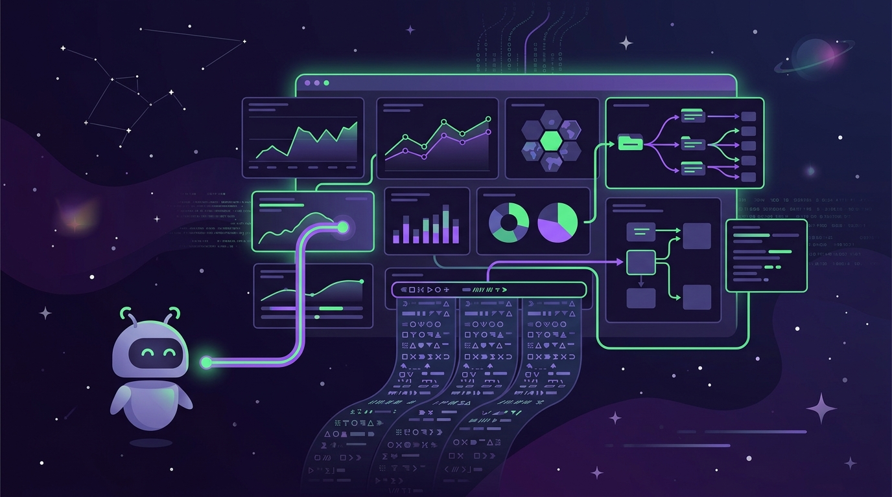

Zabbix, el veterano del monitoreo de infraestructura open source que muchos asociamos a las NOC de los 2010, soltó su versión **8.0 LTS**… y trae una agenda claramente escrita en 2026: **OpenTelemetry, ClickHouse y agentes de IA vía MCP**. La apuesta es que el monitor tradicional no tiene por qué quedarse fuera de la fiesta de la observabilidad moderna.

## OpenTelemetry nativo: trazas, métricas y logs

El cambio más grande es el **APM nativo potenciado por OpenTelemetry**. Zabbix ahora puede **recibir y analizar trazas, métricas y logs de aplicaciones** junto a los datos tradicionales de infraestructura:

- Los **proxies Zabbix** reciben telemetría por **OTLP/gRPC**, directamente desde apps o desde collectors OTel existentes.
- Una nueva sección **APM en la interfaz web** para explorar esa data.
- Un nuevo **tipo de ítem "telemetry query"** permite usar las trazas en gráficos y triggers, cerrando el círculo entre app e infra en un solo lugar.

## ClickHouse como backend histórico

La otra pata gruesa: **ClickHouse** puede almacenar ahora el histórico de métricas y la telemetría de aplicaciones. Según los desarrolladores, la nueva arquitectura de storage y las optimizaciones del servidor entregan **hasta 10x de mejora de rendimiento**, con menos CPU, menos I/O de disco y menos storage. Cualquiera que haya visto una base histórica de Zabbix inflarse sabe lo relevante que es esto.

## Correlación de eventos con lógica de causa y síntoma

Zabbix 8.0 estrena un **motor de complex event processing** que correlaciona eventos relacionados, agrupa problemas en **causas y síntomas**, identifica posibles causas raíz y reduce el ruido de alertas duplicadas. Las reglas se configuran con **lógica de matching en JavaScript** y ventanas de tiempo configurables. Menos "alerta #4.000 del día", más contexto.

## Y el guiño a la era de los agentes: MCP

Quizás lo más 2026 del release: un **servidor MCP** que permite a **agentes de IA compatibles consultar información de monitoreo, revisar historiales de problemas, reconocer alertas, ajustar severidades y gestionar ventanas de mantenimiento**. Eso sí, con correa: el acceso respeta los permisos del usuario de Zabbix asociado al token, así que el agente no puede hacer nada que la API ya no permitiera.

## Lo demás (que no es poco)

- **UI**: tablas personalizables para hosts, templates y problemas (ocultar, redimensionar, reordenar columnas), nuevo tema azul oscuro, validación inline de formularios e importación de certificados SAML directo desde la interfaz.
- **Dashboards** con funcionalidad ampliada.
- Nuevas integraciones y templates: Podman, Kubernetes, Proxmox VE, Hyper-V, MariaDB, Percona, y servicios de AWS, Azure, Google Cloud y Oracle Cloud.

## La lectura

Zabbix juega en una liga rara: no va a desplazar a Datadog ni a Grafana en el corazón de los equipos cloud-native, pero tiene una base instalada enorme en empresas, ISP y lugares donde "el monitoreo" lleva una década corriendo. Con OTel nativo, ClickHouse y MCP en la misma LTS, el mensaje es claro: **no tienen planeado ser el legacy que hay que migrar, sino el stack que ya tienes poniéndose al día**. Si tu stack Zabbix está en versión LTS anterior, esta es la versión de actualización natural.

**Fuentes:** [Zabbix 8.0 LTS en linuxiac.com](https://linuxiac.com/zabbix-8-0-lts-monitoring-platform-released-with-opentelemetry-clickhouse-and-ai-integration/) · [Zabbix](https://www.zabbix.com/)
