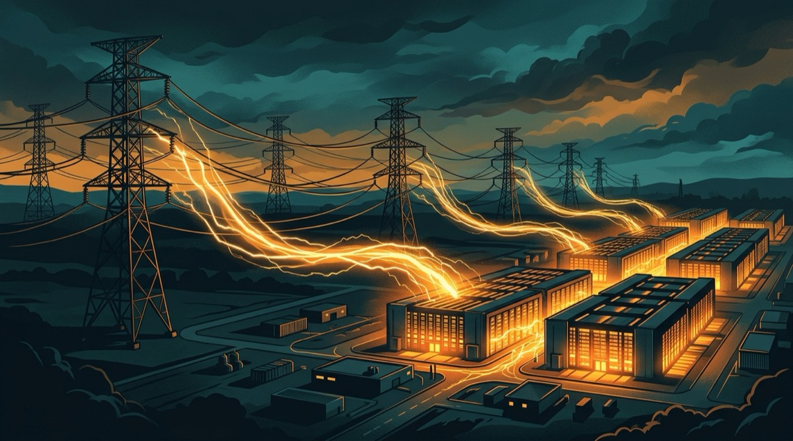

La pregunta de moda en IA dejó de ser "¿qué modelo lanzan esta semana?" y pasó a ser "¿dónde enchufo esto?". Fortune publicó este domingo un análisis que pone números al cuello de botella más incómodo del buildout: desde 2000, la energía destinada a data centers en EE.UU. ha crecido **19% al año, mientras la capacidad de la red eléctrica ha expandido apenas 2% anual**, según un análisis de la corredora de seguros Howden. Traducido: la demanda corre **diez veces más rápido** que el sistema que la alimenta.

## La matemática que no cierra

- Citigroup proyecta que Big Tech gastará **más de US$2,8 billones en infraestructura de IA hasta 2029**, y un estudio de Brookings pone la inversión en EE.UU. en **US$10,3 billones entre 2025 y 2032**.
- Los data centers tomaban ~**5% de la capacidad de la red estadounidense en 2025**. Para sostener solo esa participación hasta 2030 tendrían que conseguir hasta el **58% de su energía fuera de la grilla** (~110 GW), un nivel que el propio análisis considera improbable.
- El Laboratorio Lawrence Berkeley (DOE) proyecta que los data centers podrían consumir **hasta 12% de la electricidad de EE.UU. hacia 2028**, seis veces su participación de 1,9% en 2018.

Rob Gramlich, presidente de Grid Strategies, lo resume en una frase: hay un "mismatch de timing" entre la velocidad a la que los data centers quieren energía y la lentitud con que se expande la red. Las utilities, además, tras ~25 años sin crecimiento de demanda, "perdieron la práctica" de construir infraestructura nueva. Resultado previsible: Marsh estima que **entre 50% y 60% de los proyectos de data centers se retrasarán** más allá de los plazos de uno a dos años que manejan sus desarrolladores.

## La política ya está en el tablero

Esto dejó de ser solo ingeniería. En las midterm del **3 de noviembre, los votantes rechazaron proyectos de data centers en 40 de las 41 medidas locales** en que aparecieron en boleta. La razón de fondo: la cuenta de la luz. En Virginia del Norte —la mayor concentración de data centers del mundo— el **59% de la electricidad se vende a clientes comerciales**, y en 23 estados más Washington D.C. la demanda comercial ya supera la residencial. Encuesta del Annenberg Public Policy Center: **70% de los adultos menores de 30 se opone** a tener un data center en su zona.

## Qué significa para quien opera en la nube

Para equipos de plataforma y FinOps, la lectura es directa:

- Los cuellos de botella energéticos van a traducirse, región por región, en **capacidad más escasa y más cara**. Elegir región dejó de ser solo latencia y compliance: hoy es acceso a energía.
- Esperen más anuncios de energía dedicada —nuclear, geotermia, esquemas off-grid— pegados a cada campus nuevo que anuncien los hyperscalers.
- Planificar capacidad a 2028 asumiendo que "la nube es infinita" no pasa ningún stress test serio.

La próxima vez que alguien pregunte cuál es el cuello de botella de la IA, la respuesta ya no es un chip: es un transformador, una línea de transmisión y una asamblea vecinal con la boleta de la luz en la mano.

**Fuentes:** [Fortune](https://fortune.com/2026/11/22/ai-data-centers-power-grid-capacity/) · [Howden vía Insurance Business](https://www.insurancebusinessmag.com/us/news/property/data-center-power-demand-is-outpacing-the-grid-tenfold-and-new-risks-follow-597143.aspx) · [DOE](https://www.energy.gov/articles/doe-releases-new-report-evaluating-increase-electricity-demand-data-centers) · [Annenberg](https://www.annenbergpublicpolicycenter.org/opposition-to-local-data-centers-rises-sharply/)
