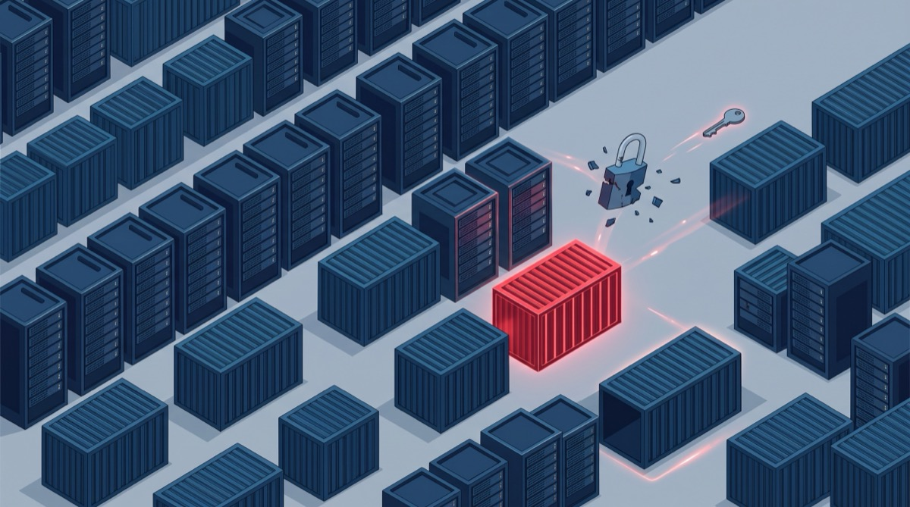

Domingo de postmortem ajeno. Rackspace notificó a sus clientes una brecha en **Rackspace Spot**, su plataforma para desplegar aplicaciones containerizadas con Kubernetes (co-desarrollada con Platform9): un actor no autorizado usó **credenciales filtradas** para operar dentro de la plataforma durante casi 22 horas seguidas.

## Qué pudieron hacer los atacantes

La ventana fue el **17 de noviembre, entre las 00:20 y las 22:00 UTC**. Con credenciales válidas, los atacantes pudieron actuar como usuarios legítimos en algunas organizaciones cliente:

- **Crear pods** en clusters de Kubernetes de clientes afectados.
- **Leer Kubernetes Secrets**: contraseñas, tokens de autenticación y API keys de bases de datos, servicios cloud y terceros.
- **Listar nodos y volúmenes** de los clusters.
- Acceder a **tokens de API de Spot y refresh tokens** del usuario comprometido, con los que la filtración podría propagarse a sistemas externos.

Rackspace se enteró el **18 de noviembre** gracias al reporte de un cliente, y confirmó los afectados ese mismo día.

## La respuesta (y la caída que vino incluida)

La empresa revocó tokens y sesiones, eliminó los pods no autorizados, rotó llaves y reforzó controles. Pero hay un detalle incómodo: durante la contención, **la consola de administración de Spot estuvo caída varios días**, dejando a clientes sin poder gestionar sus clusters ni rotar credenciales justo cuando más lo necesitaban. Sirish Raghuram, cofundador de Platform9, asumió en Reddit que apagar todo fue una decisión deliberada para sanitizar el entorno. El servicio se restauró por completo el **21 de noviembre**.

## IOC y checklist si eres cliente

Indicadores de compromiso entregados por Rackspace:

- IP: **23.224.79.106** (rango **23.224.0.0/15**)
- Prefijos sospechosos de pods y objetos: **i1**, **glm-** y **probe**

Si tienes workloads ahí, la lista de tareas es directa: reemitir tokens de API de Spot, reemplazar refresh tokens de herramientas de automatización, descargar kubeconfigs frescos, rotar todo lo que vivía en Secrets y revisar logs **desde el 17 de noviembre** en bases de datos, registros de contenedores, repos Git, storage y servicios de terceros.

## La lección que va más allá de Rackspace

Esto no fue un exploit de día cero ni magia oscura: fueron **credenciales filtradas operando como un usuario legítimo**. El playbook defensivo es el de siempre, pero ahora con agentividad de por medio: credenciales de corta vida en vez de tokens eternos, secrets externos al cluster en vez de YAML en etcd, políticas de egress restrictivas y alertas ante pods con nombres que no calzan con ninguna etiqueta de tu equipo. La detección tardó un día y un cliente atento; la sanitización, cuatro. Haz cuentas con eso.

**Fuentes:** [BleepingComputer](https://www.bleepingcomputer.com/news/security/rackspace-spot-breach-let-hackers-access-customer-kubernetes-secrets/) · [Reddit r/rxt_spot — servicio restaurado](https://www.reddit.com/r/rxt_spot/comments/1y22b0d/service_fully_restored/)
